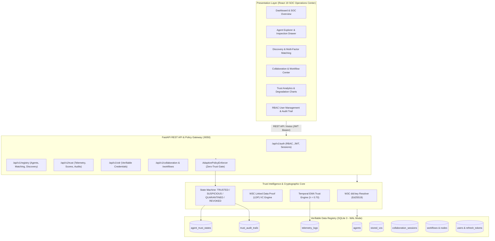
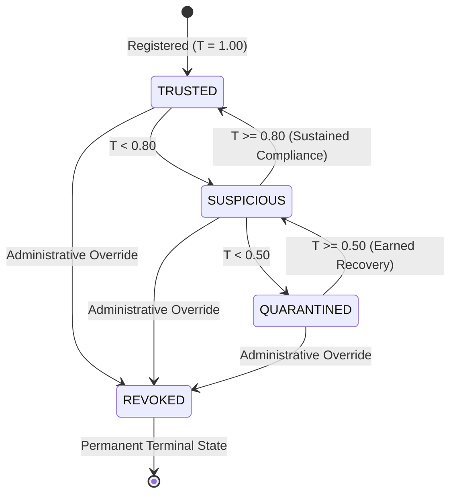

# TrustChain-AI: A Decentralized Trust Intelligence Framework for Secure Autonomous AI Agent Collaboration

[](https://fastapi.tiangolo.com)
[](https://react.dev/)
[](https://vitejs.dev/)
[](https://python.org)
[](https://sqlite.org)
[-005A9C.svg)](https://www.w3.org/TR/did-core/)
[-brightgreen.svg)]()
[](LICENSE)

> **Department of Computer Engineering, Mukesh Patel School of Technology Management & Engineering (MPSTME)**  
> **SVKM's NMIMS (Deemed-to-be University), Mumbai**  
> *Final-Year B.Tech Capstone Project · Academic Session 2026–2027*

---

## Table of Contents

1. [Project Title & Introduction](#1-project-title--introduction)
2. [Project Overview & Implementation Status](#2-project-overview--implementation-status)
3. [Key Features](#3-key-features)
4. [System Architecture](#4-system-architecture)
5. [Technology Stack](#5-technology-stack)
6. [Repository Structure](#6-repository-structure)
7. [System Requirements](#7-system-requirements)
8. [Installation & Setup](#8-installation--setup)
9. [Environment Variable Configuration](#9-environment-variable-configuration)
10. [Database Setup & VDR Architecture](#10-database-setup--vdr-architecture)
11. [Running the Application](#11-running-the-application)
12. [Docker Deployment](#12-docker-deployment)
13. [API Documentation (39 Endpoints)](#13-api-documentation)
14. [Trust Evaluation Algorithm & Math Model](#14-trust-evaluation-algorithm--math-model)
15. [Agent Discovery vs. Task-Aware Matching](#15-agent-discovery-vs-task-aware-matching)
16. [Visual Assets & Application Walkthrough](#16-visual-assets--application-walkthrough)
17. [Testing & Empirical Validation](#17-testing--empirical-validation)
18. [Troubleshooting Guide](#18-troubleshooting-guide)
19. [Security Considerations & Threat Model](#19-security-considerations)
20. [Limitations & Future Enhancements](#20-limitations--future-enhancements)
21. [Academic Information & Attributions](#21-academic-information--attributions)
22. [License & Contributing](#22-license--contributing)

---

## 1. Project Title & Introduction

**TrustChain-AI: A Decentralized Trust Intelligence Framework for Secure Autonomous AI Agent Collaboration**

In autonomous Multi-Agent Systems (MAS), independent software agents powered by Large Language Models (LLMs) dynamically discover external tools, delegate computational sub-tasks, and orchestrate complex multi-step pipelines without direct human oversight. However, current agent architectures suffer from a critical vulnerability: **The Point-in-Time Security Failure**.

### The Core Vulnerability
Traditional access control models verify an agent's identity only once at connection initialization ($t = 0$) using static API tokens, mTLS certificates, or OAuth2 bearer tokens. Once admitted, the agent is granted perpetual, blind trust. However, autonomous agents operate non-deterministically: an authenticated agent may experience prompt injection attacks, goal drift, reasoning hallucinations, SLA latency degradation, or resource exhaustion at runtime ($t > 0$). Static point-in-time identity provides zero visibility into post-authentication operational health.

### The TrustChain-AI Solution
TrustChain-AI introduces **Continuous Zero-Trust Governance** for multi-agent systems:
1. **Decentralized Cryptographic Identity:** Every agent is algorithmically anchored to a self-certifying W3C `did:key` identifier using Ed25519 public-key cryptography and W3C Linked Data Proof (LDP) Verifiable Credentials without reliance on a centralized Certificate Authority (CA).
2. **Behavioral Trust Intelligence:** The system continuously collects runtime telemetry streams (task success rate, protocol compliance violations, and execution latency) and processes them through an Exponential Moving Average (EMA) mathematical model.
3. **Adaptive Zero-Trust Gating:** The `AdaptivePolicyEnforcer` evaluates trust states dynamically at the boundary of every tool invocation and workflow step—granting full access to `TRUSTED` agents, restricting privileged actions for `SUSPICIOUS` agents, and isolating degraded nodes via `QUARANTINED` status (HTTP 403 Forbidden).

---

## 2. Project Overview & Implementation Status

To provide technical transparency, every system capability is mapped directly to its concrete implementation status:

| Platform Capability | Description | Status | Evidence |
|---|---|:---:|---|
| **W3C `did:key` Identity** | Algorithmic Ed25519 public key resolution (`0xED01`, multibase `z...`) | **Implemented** | `akta/did.py` |
| **W3C Verifiable Credentials** | Linked Data Proofs with URDNA2015 canonicalization & `Ed25519Signature2020` | **Implemented** | `akta/credentials.py` |
| **Behavioral Telemetry Pipeline** | Sliding-window ingestion of task success flags, compliance violations, and latency | **Implemented** | `akta/telemetry.py` |
| **Temporal EMA Trust Engine** | Discrete dynamical system: $T_i(t) = 0.7 T_i(t-1) + 0.3 P_i(t)$ | **Implemented** | `akta/trust_engine.py` |
| **Four-State Machine Engine** | Transitions across `TRUSTED`, `SUSPICIOUS`, `QUARANTINED`, and `REVOKED` | **Implemented** | `akta/trust_engine.py` |
| **Zero-Trust Policy Enforcer** | Gating layer denying quarantined nodes (HTTP 403) and restricting suspicious nodes | **Implemented** | `akta/adaptive_auth.py` |
| **Autonomous Agent Registry** | Catalog of registered agents, model backbones, endpoints, and health probes | **Implemented** | `akta/vdr/registry_router.py` |
| **Eligibility-Based Discovery** | Capability filtering excluding quarantined, revoked, or offline agents | **Implemented** | `akta/vdr/registry_crud.py` |
| **Task-Aware Multi-Factor Matching** | Composite ranking: Trust (40%), Reputation (30%), Success (20%), Latency (10%) | **Implemented** | `akta/vdr/registry_crud.py` |
| **Collaboration Sessions** | Inter-agent messaging, payload exchange, and session productivity scoring | **Implemented** | `akta/vdr/registry_router.py` |
| **Sequential Workflow DAGs** | Multi-node sequential task pipelines with intermediate trust-gate validation | **Implemented** | `akta/vdr/registry_router.py` |
| **State Machine Audit Trail** | Cryptographically recorded state transitions with natural language reasons | **Implemented** | `akta/vdr/trust_crud.py` |
| **Human RBAC Authentication** | Argon2 hashing, JWT access tokens, rotating refresh tokens with reuse detection | **Implemented** | `akta/auth/` |
| **Interactive SOC Dashboard** | 16 views in React 19, Recharts temporal graphs, Lucide icons, dark theme | **Implemented** | `frontend/src/` |
| **Simulated Tool Connectors** | Deterministic mock connectors for simulated external tools (`/map/generate`) | **Simulated** | `akta/connectors.py` |
| **Distributed Blockchain VDR** | Decentralized on-chain registry anchoring (current VDR is local SQLite) | **Planned** | Future Scope |

---

## 3. Key Features

- **Self-Certifying Decentralized Identifiers (DIDs):** Eliminates centralized CA vulnerabilities; public verification keys are derived directly from the identifier string.
- **Continuous Mathematical Trust Evaluation:** Fuses immediate task performance with historical reputation memory via temporal Exponential Moving Average (EMA) smoothing.
- **Granular Zero-Trust Authorization:** Differentiates between standard lower-risk tasks and privileged orchestration actions, preventing lateral privilege escalation.
- **Transparent Multi-Factor Matching:** Ranks candidate agents using an explainable four-factor composite score with full mathematical breakdown for auditors.
- **Cryptographic Refresh Token Rotation:** Protects human operator sessions against token theft with automated family invalidation upon reuse detection.
- **High-Performance Embedded VDR:** Operates over local SQLite 3 in WAL mode, delivering sub-millisecond query execution without blockchain gas costs or consensus delays.
- **Live SOC Operations Center:** Real-time single-page application built with React 19, Vite, and TailwindCSS providing comprehensive observability.

---

## 4. System Architecture



---

## 5. Technology Stack

| Layer | Technology | Version | Purpose |
|---|---|---|---|
| **Frontend Framework** | React | `19.2.8` | Component-driven user interface |
| **Frontend Bundler** | Vite | `8.2.2` | High-speed build tool and dev server |
| **Frontend Routing** | React Router | `7.18.3` | Client-side declarative routing |
| **Frontend Styling** | TailwindCSS | `4.3.3` | Utility-first responsive dark SOC theme |
| **UI Visualizations** | Recharts | `3.10.1` | Real-time temporal decay and radar charts |
| **UI Icons** | Lucide React | `1.38.0` | Security and network iconography |
| **Backend Framework** | FastAPI | `0.141.1` | High-performance asynchronous REST API |
| **ASGI Server** | Uvicorn | `0.52.4` | Production ASGI web server |
| **Data Validation** | Pydantic / Settings | `2.13.5` / `2.15.0` | Strict schema validation & config loader |
| **Database ORM** | SQLAlchemy | `2.0.52` | Relational persistence & query builder |
| **Database Engine** | SQLite 3 | `3.x` (WAL Mode) | Embedded ACID Verifiable Data Registry |
| **Cryptographic Engine** | PyNaCl (libsodium) | `1.6.2` | Ed25519 signature generation & verification |
| **VC Linked Data Proofs**| PyLD | `3.2.0` | URDNA2015 RDF dataset canonicalization |
| **Encoding Format** | Base58 | `2.1.1` | Multibase base58btc (`z...`) key encoding |
| **Password Security** | Argon2-cffi / Passlib | `25.1.0` / `1.7.4` | Memory-hard password hashing |
| **Token Security** | PyJWT | `2.14.0` | HMAC-SHA256 signed access tokens |
| **Automated Testing** | Pytest / Pytest-Mock | `9.1.1` / `3.15.1` | Unit, integration & security test harness |
| **Static Code Analysis**| Oxlint | `1.79.0` | High-speed frontend linter |

---

## 6. Repository Structure

```text
trustchain-ai/
├── README.md                           # Master architectural & execution documentation
├── LICENSE                             # Apache License 2.0
├── .gitignore                          # Exclusions for Python, Node, Vite, SQLite, OS
├── .gitattributes                      # Line endings (LF) and binary format configurations
├── .env.example                        # Template for backend environment variables
├── requirements.txt                    # Verified Python backend dependencies
├── pyproject.toml                      # Project metadata and package definitions
├── pytest.ini                          # Pytest configuration and warning filters
├── Dockerfile                          # Production container specification for backend
├── docker-compose.yml                  # Multi-container orchestration (Backend + Frontend)
├── Makefile                            # Developer automation shortcuts
├── START_TRUSTCHAIN.bat                # Automated two-window launcher for Windows
├── STOP_TRUSTCHAIN.bat                 # Clean shutdown script for Windows
│
├── akta/                               # Core Backend Python Package
│   ├── auth/                           # RBAC, Argon2 hashing, JWT rotation, security audit
│   │   ├── crud.py                     # User creation, session tracking, audit logger
│   │   ├── dependencies.py             # FastAPI security dependencies (get_current_user)
│   │   ├── router.py                   # Auth endpoints (/login, /refresh, /users, /audit)
│   │   ├── schemas.py                  # Pydantic auth schemas
│   │   └── security.py                 # Cryptographic token & password functions
│   ├── commands/                       # CLI tool subcommands (claim, keys, registry, trust)
│   ├── vdr/                            # Verifiable Data Registry & Database Subsystem
│   │   ├── database.py                 # SQLAlchemy engine, session maker, WAL pragmas
│   │   ├── models.py                   # 13 relational database models
│   │   ├── registry_crud.py            # Agent registry, health probe, matching algorithm
│   │   ├── registry_router.py          # Registry, discovery, matching & workflow routes
│   │   ├── router.py                   # VDR, VC storage, telemetry & trust routes
│   │   ├── schemas.py                  # Pydantic schemas for registry, VCs, matching
│   │   └── trust_crud.py               # Database queries for telemetry and trust state
│   ├── adaptive_auth.py                # AdaptivePolicyEnforcer (Zero-trust policy gate)
│   ├── cli.py                          # CLI entry point
│   ├── config.py                       # Pydantic BaseSettings configuration loader
│   ├── connectors.py                   # Simulated & deterministic tool connectors
│   ├── credentials.py                  # W3C Verifiable Credential builder & LDP signer
│   ├── did.py                          # W3C did:key algorithmic resolver & Ed25519 keys
│   ├── exceptions.py                   # Domain exception hierarchy
│   ├── logging.py                      # Structured JSON logger with X-Request-ID tracking
│   ├── server.py                       # FastAPI application factory & /health probe
│   ├── telemetry.py                    # Telemetry event models & observation harnesses
│   └── trust_engine.py                 # Mathematical Trust Core (EMA decay & scoring)
│
├── frontend/                           # React 19 SOC Operations Center Single Page App
│   ├── src/
│   │   ├── components/                 # 16 interactive SOC views and UI controls
│   │   │   ├── AgentDetails.jsx        # Agent inspection drawer with DID key & VC proofs
│   │   │   ├── AgentExplorer.jsx       # Interactive catalog of registered agents
│   │   │   ├── AuditTrail.jsx          # Security and state machine audit history
│   │   │   ├── AuthorizationVisualizer.jsx # Zero-trust policy enforcement simulator
│   │   │   ├── CollaborationCenter.jsx # Multi-agent messaging & session orchestrator
│   │   │   ├── DashboardHome.jsx       # SOC telemetry overview and summary cards
│   │   │   ├── DiscoveryCenter.jsx     # Eligibility-based candidate discovery
│   │   │   ├── IdentityCredentials.jsx # W3C did:key resolver & VC inspector
│   │   │   ├── LoginPage.jsx           # User authentication portal
│   │   │   ├── MatchingCenter.jsx      # Multi-factor task-aware matching visualizer
│   │   │   ├── StateTransitionMap.jsx  # Interactive state machine diagram
│   │   │   ├── SystemHealth.jsx        # Real-time FastAPI, SQLite, and Trust Math probes
│   │   │   ├── TelemetryCenter.jsx     # Live telemetry event ingestion tester
│   │   │   ├── TrustAnalytics.jsx      # Mathematical trust charts & decay timelines
│   │   │   ├── UserManagement.jsx      # RBAC user administration & session revocation
│   │   │   └── WorkflowCenter.jsx      # Sequential multi-agent workflow executor
│   │   ├── context/                    # AuthContext and ThemeContext providers
│   │   ├── hooks/                      # Custom data fetching hooks (useApi)
│   │   ├── api.js                      # Axios HTTP client with Bearer auth & refresh
│   │   ├── App.jsx                     # Master application shell & React Router routes
│   │   └── main.jsx                    # React 19 application entry point
│   ├── Dockerfile                      # Multi-stage production container for frontend
│   ├── nginx.conf                      # Nginx reverse proxy & SPA client routing config
│   ├── package.json                    # Frontend dependencies & npm scripts
│   ├── package-lock.json               # Locked frontend dependency tree
│   ├── vite.config.js                  # Vite 8 configuration
│   └── README.md                       # Frontend architectural & build documentation
│
├── database/                           # Persistent Storage Definitions
│   ├── schema/
│   │   └── schema.sql                  # Complete SQLite DDL export for all 13 tables
│   └── README.md                       # VDR architecture, concurrency, and backup guide
│
├── tests/                              # Automated Pytest Test Harness (80 Tests)
│   ├── commands/                       # Unit tests for CLI tools (claim, keys, registry)
│   ├── test_adaptive_policy.py         # Zero-Trust policy enforcer & gating tests (7 tests)
│   ├── test_authentication.py          # RBAC, Argon2, JWT & token rotation tests (28 tests)
│   ├── test_cli.py                     # CLI entry point verification (1 test)
│   ├── test_e2e_lifecycle.py           # End-to-end registration to quarantine tests (3 tests)
│   ├── test_investigation_discovery_matching.py # Discovery & matching tests (3 tests)
│   ├── test_multi_agent.py             # Collaboration session & messaging tests (3 tests)
│   ├── test_platform_features.py       # Telemetry ingestion & recovery tests (3 tests)
│   └── test_system_health.py           # Subsystem health & fault injection tests (4 tests)
│
├── scripts/                            # Operational & Reproducibility Utilities
│   ├── database/
│   │   ├── init_db.py                  # Automated schema table initialization
│   │   └── seed_demo_data.py           # Offline demonstration agent & credential seeder
│   ├── setup/
│   │   └── setup_environment.py        # System prerequisites & environment sanity checker
│   └── development/
│       └── run_tests.py                # Unified runner for pytest and frontend build
│
├── screenshots/                        # High-Resolution Architectural & UI Assets
│   ├── dashboard/                      # SOC dashboard & telemetry pipeline assets
│   ├── agents/                         # W3C did:key, VC lifecycle, and state machine assets
│   ├── discovery/                      # Discovery flowchart and candidate filtering assets
│   ├── matching/                       # Multi-factor matching breakdown and flowcharts
│   ├── collaboration/                  # Collaboration sequence diagrams and workflow assets
│   └── administration/                 # Zero-trust policy matrix and test verification charts
│
├── docs/                               # Comprehensive Technical & Academic Documentation
│   ├── GITHUB_RELEASE_AUDIT.md         # Full project audit findings & remediations
│   ├── RELEASE_VALIDATION_REPORT.md    # Pre-release validation outputs & test certification
│   ├── PROJECT_OVERVIEW.md             # Theoretical foundation & capability matrix
│   ├── SYSTEM_ARCHITECTURE.md          # Architectural blueprints & sequence diagrams
│   ├── DATABASE_DESIGN.md              # Detailed schema design & SQLite VDR specification
│   ├── API_DOCUMENTATION.md            # Complete REST API reference for all 39 endpoints
│   ├── TRUST_ALGORITHM.md              # Mathematical derivation & numerical walkthrough
│   ├── SECURITY_MODEL.md               # Zero-trust threat modeling & STRIDE matrix
│   ├── INSTALLATION_GUIDE.md           # Step-by-step setup for Windows, Linux, and macOS
│   ├── TROUBLESHOOTING.md              # Resolutions for 10 common real-world errors
│   ├── TESTING_GUIDE.md                # Test suite breakdown & manual verification guide
│   ├── DEVELOPMENT_GUIDE.md            # Contributor workflows, PR guide & coding standards
│   ├── presentation/                   # Complete capstone presentation slides & notes
│   │   ├── final/                      # Presentation PDF, PPTX, and slide-by-slide notes
│   │   └── TrustChain_AI_Slide_Assets/ # Raw publication-quality diagram assets
│   └── blackbook/                      # Academic thesis documentation & code inventory
│
└── .github/                            # GitHub Community & Automation Infrastructure
    ├── workflows/
    │   └── ci.yml                      # GitHub Actions CI workflow (Tests + Build)
    ├── ISSUE_TEMPLATE/
    │   ├── bug_report.md               # Standardized bug reporting template
    │   └── feature_request.md          # Standardized architectural enhancement template
    └── pull_request_template.md        # Pull request verification checklist
```

---

## 7. System Requirements

- **Operating System:** Windows 10/11 (64-bit), Ubuntu 22.04/24.04 LTS, or macOS 13+ (Ventura/Sonoma).
- **Python:** Python `>= 3.11` and `< 3.14` (Verified on Python `3.12.3`).
- **Node.js & npm:** Node.js `>= 18.0.0` (Node `20.x` LTS recommended), npm `>= 9.0.0`.
- **Hardware:** 4 GB RAM minimum (8 GB recommended); 2 GB free disk storage.
- **Docker (Optional):** Docker Engine `>= 24.0` and Docker Compose `>= 2.20` if running containerized.
- **Port Availability:** TCP Port `8050` (FastAPI backend) and TCP Port `5173` (React frontend).

---

## 8. Installation & Setup

### Windows PowerShell Quickstart

```powershell
# 1. Clone repository
git clone https://github.com/Manishpatil0608/trustchain-ai.git
cd trustchain-ai

# 2. Configure environment variables
Copy-Item .env.example .env

# 3. Create and activate Python virtual environment
python -m venv .venv
.\.venv\Scripts\Activate.ps1

# 4. Install backend dependencies
python -m pip install --upgrade pip
pip install -r requirements.txt

# 5. Initialize database & seed safe demonstration agents
python scripts/database/init_db.py
python scripts/database/seed_demo_data.py

# 6. Install frontend dependencies
cd frontend
npm ci
cd ..
```

### Linux / macOS Bash Quickstart

```bash
# 1. Clone repository
git clone https://github.com/Manishpatil0608/trustchain-ai.git
cd trustchain-ai

# 2. Configure environment variables
cp .env.example .env

# 3. Create and activate Python virtual environment
python3 -m venv .venv
source .venv/bin/activate

# 4. Install backend dependencies
pip install --upgrade pip
pip install -r requirements.txt

# 5. Initialize database & seed safe demonstration agents
python scripts/database/init_db.py
python scripts/database/seed_demo_data.py

# 6. Install frontend dependencies
cd frontend
npm ci
cd ..
```

---

## 9. Environment Variable Configuration

All environment variables are loaded through Pydantic BaseSettings in `akta/config.py`. Copy `.env.example` to `.env`:

```ini
# Server Network Settings
APP_HOST=127.0.0.1
APP_PORT=8050
APP_RELOAD=False
APP_APP_NAME=TrustChain-AI Platform

# Operational & Logging Settings
APP_DEBUG=False
APP_LOG_LEVEL=INFO
APP_LOG_FORMAT=json

# Persistence & SQLite VDR
APP_DATABASE_URL=sqlite:///./vdr.db

# Security & Authentication Settings
# CRITICAL: Replace with a secure 32+ byte key in production environments
APP_AUTH_SECRET=dev_secret_trustchain_ai_capstone_project_2026_key_32_bytes_min!
APP_ACCESS_TOKEN_EXPIRE_MINUTES=30
APP_REFRESH_TOKEN_EXPIRE_DAYS=7
APP_LOGIN_MAX_ATTEMPTS=5
APP_LOGIN_LOCKOUT_MINUTES=15
APP_DEV_AUTO_SEED_ADMIN=True

# Cross-Origin Resource Sharing (CORS)
APP_CORS_ALLOWED_ORIGINS=http://localhost:5173,http://127.0.0.1:5173,http://localhost:8050
```

---

## 10. Database Setup & VDR Architecture

TrustChain-AI uses an embedded SQLite 3 database operating in **Write-Ahead Logging (WAL)** mode as its local Verifiable Data Registry (VDR).

### Database Initialization
Tables are automatically created upon backend startup or by running:
```bash
python scripts/database/init_db.py
```

### Seeding Realistic Demo Data
To populate the database with realistic demo agents (Agent Alpha, Agent Beta, Agent Gamma, Agent Delta), issued credentials, and baseline telemetry:
```bash
python scripts/database/seed_demo_data.py
```

### Resetting Local Database
```bash
# On Windows PowerShell:
Remove-Item vdr.db, vdr.db-wal, vdr.db-shm -ErrorAction SilentlyContinue
python scripts/database/init_db.py
python scripts/database/seed_demo_data.py
```

---

## 11. Running the Application

### Method A: Automated Launcher (Windows)
Double-click or execute:
```cmd
START_TRUSTCHAIN.bat
```
This automatically verifies prerequisites, launches the backend on `:8050`, launches the frontend on `:5173`, and opens `http://localhost:5173` in your default browser.

To stop the services:
```cmd
STOP_TRUSTCHAIN.bat
```

### Method B: Manual Two-Terminal Execution

**Terminal 1 — FastAPI Backend:**
```bash
# Activate virtual environment
source .venv/bin/activate  # Windows: .\.venv\Scripts\Activate.ps1

# Run ASGI server
python -m uvicorn akta.server:app --host 127.0.0.1 --port 8050 --reload
```

**Terminal 2 — React/Vite Frontend:**
```bash
cd frontend
npm run dev
```

### Key Service URLs
- **Frontend SOC Portal:** [http://localhost:5173](http://localhost:5173)
- **Backend API Base:** [http://127.0.0.1:8050](http://127.0.0.1:8050)
- **Interactive Swagger UI:** [http://127.0.0.1:8050/docs](http://127.0.0.1:8050/docs)
- **Subsystem Health Check:** [http://127.0.0.1:8050/health](http://127.0.0.1:8050/health)

### Default Development Credentials
- **Username:** `admin`
- **Password:** `Admin@TrustChain2026!`
- **Role:** `ADMIN`

---

## 12. Docker Deployment

A multi-container setup is provided via `docker-compose.yml`:

```bash
# Build and run containers in detached mode
docker-compose up --build -d

# Verify container statuses
docker-compose ps

# Follow container logs
docker-compose logs -f

# Shut down containers and preserve SQLite data
docker-compose down
```

---

## 13. API Documentation

The backend exposes **39 authoritative REST endpoints**:

| Method | Endpoint | Group / Purpose | Auth Required |
|---|---|---|:---:|
| `POST` | `/api/v1/auth/login` | Authenticate username/password; return JWT & refresh cookie | None |
| `POST` | `/api/v1/auth/logout` | Revoke active refresh session | None |
| `GET` | `/api/v1/auth/me` | Retrieve profile of authenticated operator | Bearer JWT |
| `POST` | `/api/v1/auth/refresh` | Rotate refresh token with reuse detection | Cookie |
| `POST` | `/api/v1/auth/change-password` | Update password & invalidate active sessions | Bearer JWT |
| `GET` | `/api/v1/auth/users` | List platform users | `ADMIN`, `OPERATOR` |
| `POST` | `/api/v1/auth/users` | Create new operator or viewer account | `ADMIN` |
| `PATCH` | `/api/v1/auth/users/{id}/status` | Update user status or assign RBAC role | `ADMIN` |
| `POST` | `/api/v1/auth/users/{id}/revoke-sessions`| Administratively terminate user refresh tokens | `ADMIN` |
| `GET` | `/api/v1/auth/audit` | Retrieve security authentication audit trail | `ADMIN`, `OPERATOR` |
| `POST` | `/api/v1/registry/agents` | Register autonomous agent; generate or validate W3C `did:key` | None |
| `GET` | `/api/v1/registry/agents` | List registered agents with capability filters | None |
| `GET` | `/api/v1/registry/agents/{id}` | Retrieve agent profile and health status | None |
| `POST` | `/api/v1/registry/agents/{id}/health` | Trigger live availability & responsiveness health probe | None |
| `POST` | `/api/v1/registry/agents/{did}/status`| Update agent operational status (`AVAILABLE`/`BUSY`/`OFFLINE`) | None |
| `GET` | `/api/v1/registry/discover` | Discover candidate agents satisfying eligibility criteria | None |
| `POST` | `/api/v1/registry/matching` | Rank candidates using transparent multi-factor matching score | None |
| `GET` | `/api/v1/registry/stats` | Global network registry summary statistics | None |
| `POST` | `/api/v1/trust/telemetry` | Ingest runtime telemetry event (success, compliance, latency) | None |
| `GET` | `/api/v1/trust/telemetry` | Retrieve recent 100 system-wide telemetry observations | None |
| `GET` | `/api/v1/trust/telemetry/{did}` | Retrieve historical telemetry stream for target agent DID | None |
| `GET` | `/api/v1/trust/state/{did}` | Compute and return current temporal trust score & state | None |
| `GET` | `/api/v1/trust/agents` | List all agents with active trust scores & states | None |
| `GET` | `/api/v1/trust/audit` | State machine transition audit log across all agents | None |
| `GET` | `/api/v1/trust/audit/{did}` | Lifecycle state transition history for specific agent DID | None |
| `POST` | `/api/v1/trust/revoke/{did}` | Administratively revoke agent (terminal state transition) | `ADMIN` |
| `GET` | `/api/v1/trust/dashboard` | Built-in lightweight HTML diagnostics dashboard | None |
| `POST` | `/api/v1/vdr` | Store issued W3C Verifiable Credential with Linked Data Proof | None |
| `GET` | `/api/v1/vdr/{vc_id}` | Retrieve Verifiable Credential by unique identifier | None |
| `GET` | `/api/v1/vdr/credentials/subject/{did}`| Retrieve all active VCs issued to subject DID | None |
| `POST` | `/api/v1/collaboration/request` | Initiate collaboration session between requester & target DIDs | None |
| `GET` | `/api/v1/collaboration/sessions` | List active and historical collaboration sessions | None |
| `GET` | `/api/v1/collaboration/sessions/{id}` | Retrieve session events, status, and productivity score | None |
| `POST` | `/api/v1/collaboration/sessions/{id}/step`| Execute collaborative task step / exchange payload | None |
| `POST` | `/api/v1/collaboration/sessions/{id}/terminate`| Terminate ongoing collaboration session early | None |
| `POST` | `/api/v1/collaboration/rate` | Submit post-collaboration peer evaluation rating (1-5) | None |
| `POST` | `/api/v1/workflows` | Register sequential or parallel multi-agent workflow DAG | None |
| `GET` | `/api/v1/workflows` | List registered workflows and operational statuses | None |
| `GET` | `/api/v1/workflows/{id}` | Retrieve workflow nodes and intermediate execution statuses | None |
| `POST` | `/api/v1/workflows/{id}/execute` | Execute workflow steps with zero-trust gate verification | None |
| `GET` | `/health` | Subsystem health probe (FastAPI, SQLite, Trust Math) | None |
| `GET` | `/api/v1/.well-known/agent.json` | A2A Agent Card specification discovery endpoint | None |
| `POST` | `/api/v1/map/generate` | Demonstration tool execution endpoint; zero-trust gated | None |

---

## 14. Trust Evaluation Algorithm & Math Model

The TrustChain-AI mathematical model (`akta/trust_engine.py`) models trust as a continuous discrete-time dynamical system:

### 1. Single-Period Behavioral Score ($P_i(t)$)
For agent $i$ over observation window $t$:

$$P_i(t) = 0.60 \cdot S_i(t) + 0.30 \cdot C_i(t) + 0.10 \cdot (1 - L_i(t))$$

- **$S_i(t) \in [0, 1]$:** Task Success Rate (ratio of successful task completions to total tasks).
- **$C_i(t) \in [0, 1]$:** Protocol Compliance Rate (ratio of compliant executions to total observations).
- **$L_i(t) \in [0, 1]$:** Normalized Latency Penalty, where $L_i(t) = \min(1.0, \text{latency\_ms} / 2000.0)$.

### 2. Temporal Trust Smoothing ($T_i(t)$)
Historical memory is retained using an Exponential Moving Average (EMA) with decay coefficient $\lambda = 0.70$:

$$T_i(t) = 0.70 \cdot T_i(t-1) + 0.30 \cdot P_i(t)$$

- **$T_i(0) = 1.00$:** Optimistic baseline initialization upon cryptographic DID registration.
- **$\lambda = 0.70$:** Provides high resilience against single-packet noise while responding swiftly to sustained behavioral degradation.

### 3. Four-State Deterministic Thresholds



- **`TRUSTED` ($T \ge 0.80$):** Unrestricted access to standard and privileged operations.
- **`SUSPICIOUS` ($0.50 \le T < 0.80$):** Restricted access. Privileged operations (`workflow:execute`, `agent:delegate`, `admin:revoke`) are blocked with HTTP 403; standard operations are permitted under heightened monitoring and security audit logging.
- **`QUARANTINED` ($T < 0.50$):** Zero-trust isolation. All protected operations return HTTP 403 Forbidden.
- **`REVOKED` (Terminal State):** Permanent administrative revocation. Irreversible regardless of subsequent telemetry.

---

## 15. Agent Discovery vs. Task-Aware Matching

TrustChain-AI maintains a strict separation between candidate **Discovery** and task-aware **Matching**:

### A. Discovery (Eligibility Filtering)
Finds all registered candidate agents that satisfy baseline operational criteria:
1. Operational status must be `AVAILABLE` (excludes `BUSY` and `OFFLINE`).
2. Endpoint health check must report `HEALTHY`.
3. Trust state must **not** be `QUARANTINED` or `REVOKED`.
4. Agent capability string must contain the requested capability keyword.

### B. Matching (Multi-Factor Composite Ranking)
Ranks eligible candidates for a specific delegation task using an explainable multi-factor composite formulation:

$$\text{MatchScore} = 0.40 \cdot T_i + 0.30 \cdot \left(\frac{R_i}{5.0}\right) + 0.20 \cdot S_i + 0.10 \cdot (1 - \text{norm\_lat})$$

- **$T_i$ (Weight = 0.40):** Active Temporal Trust Score.
- **$R_i / 5.0$ (Weight = 0.30):** Normalized Peer Reputation Score on a 1.0–5.0 scale.
- **$S_i$ (Weight = 0.20):** Historical Task Success Rate ($\text{successful\_tasks} / \text{total\_tasks}$).
- **$1 - \text{norm\_lat}$ (Weight = 0.10):** Latency Performance Factor ($1 - \min(\text{latency\_ms} / 2000.0, 1.0)$).

**Policy Interception Boundaries:**
- Quarantined or Revoked agents: `REJECTED BY POLICY` (Score: 0.0).
- Suspicious agents requesting privileged capabilities: `REJECTED BY POLICY` (Score: 0.0).
- Agents falling below requested minimum trust threshold: `REJECTED BY POLICY` (Score: 0.0).
- Eligible agents: Evaluated via composite formulation and sorted in descending order.

---

## 16. Visual Assets & Application Walkthrough

The repository includes high-resolution visual evidence generated from the verified codebase:

| Subsystem / View | Visual Diagram | Description |
|---|:---:|---|
| **System Architecture** | `screenshots/architecture_diagram.png` | End-to-end multi-layer architectural blueprint |
| **Telemetry & Degradation**| `screenshots/dashboard/trust_timeline.png` | 10-round degradation and recovery curve |
| **W3C DID & VC Lifecycle**| `screenshots/agents/did_vc_lifecycle.png` | Algorithmic key generation, signing, and VDR persistence |
| **Trust State Machine** | `screenshots/agents/trust_state_machine.png`| Four-state transition model and score boundaries |
| **Zero-Trust Policy Matrix**| `screenshots/administration/auth_matrix.png` | Gating rules across roles and trust classifications |
| **Discovery Flowchart** | `screenshots/discovery/discovery_flowchart.png`| Binary eligibility filter sequence |
| **Matching Flowchart** | `screenshots/matching/matching_flowchart.png` | Multi-factor candidate ranking pipeline |
| **Matching Score Breakdown**| `screenshots/matching/matching_breakdown.png`| Factor-by-factor score breakdown for top candidates |
| **Collaboration Workflow**| `screenshots/collaboration/collaboration_sequence.png`| Sequential DAG execution with trust-gate verification |
| **Database ER Model** | `screenshots/administration/database_er_diagram.png`| 13 relational tables and foreign-key relationships |
| **Empirical Verification** | `screenshots/administration/test_results_chart.png`| 80/80 passing tests distribution across modules |

---

## 17. Testing & Empirical Validation

TrustChain-AI includes an automated test harness with **80 passing test cases**:

```bash
# Execute automated backend test suite
pytest tests/ -v
```

### Test Suite Execution Output
```text
tests/commands/test_claim.py ...........                                 [ 13%]
tests/commands/test_keys.py ....                                         [ 18%]
tests/commands/test_registry.py .......                                  [ 27%]
tests/commands/test_token.py ...                                         [ 31%]
tests/commands/test_vdr.py ...                                           [ 35%]
tests/test_adaptive_policy.py .......                                    [ 43%]
tests/test_authentication.py ...................................         [ 78%]
tests/test_cli.py .                                                      [ 80%]
tests/test_e2e_lifecycle.py ...                                          [ 83%]
tests/test_investigation_discovery_matching.py ...                       [ 87%]
tests/test_multi_agent.py ...                                            [ 91%]
tests/test_platform_features.py ...                                      [ 95%]
tests/test_system_health.py ....                                         [100%]

====================== 80 passed, 96 warnings in 18.76s =======================
```

### Frontend Build Verification
```bash
cd frontend && npm run build
```
**Result:** 2,478 modules transformed cleanly in 26.17s.

---

## 18. Troubleshooting Guide

| Issue / Symptom | Likely Cause | Resolution |
|---|---|---|
| `Port 8050 already in use` | Zombie Uvicorn process holding socket | Run `STOP_TRUSTCHAIN.bat` or `netstat -ano \| findstr :8050` and kill PID |
| `Port 5173 already in use` | Background Vite server active | Terminate PID listening on 5173: `taskkill /F /PID <PID>` |
| `sqlite3.OperationalError: database locked` | Uncheckpointed WAL transaction | Run `python -c "import sqlite3; c=sqlite3.connect('vdr.db'); c.execute('PRAGMA wal_checkpoint(TRUNCATE)'); c.close()"` |
| `PowerShell execution policy error` | Restricted script policy on Windows | Execute `Set-ExecutionPolicy -ExecutionPolicy RemoteSigned -Scope Process` |
| `CORS error on API requests` | Origin missing from `.env` | Ensure `APP_CORS_ALLOWED_ORIGINS=http://localhost:5173,http://localhost:8050` |
| `Admin login rejected` | Database initialized without seeding | Run `python scripts/database/seed_demo_data.py` to restore `admin` account |
| `PyLD network failure` | Air-gapped environment blocking w3.org | Use `scripts/database/seed_demo_data.py` for offline-safe VC generation |

*For complete resolutions, see [docs/TROUBLESHOOTING.md](docs/TROUBLESHOOTING.md).*

---

## 19. Security Considerations

- **Private Key Isolation:** Agent signing keys are generated locally and never transmitted across REST boundaries.
- **Password Security:** Human operator passwords are hashed using Argon2id with per-user dynamic salts.
- **JWT Protection:** Access tokens are signed using HMAC-SHA256 with 30-minute expiration.
- **Refresh Token Invalidation:** Refresh tokens rotate on every invocation; reuse attempts immediately terminate all sessions for the affected user.
- **Zero-Trust Enforcement:** The `AdaptivePolicyEnforcer` executes prior to business logic, preventing bypassed authorization.

---

## 20. Limitations & Future Enhancements

1. **Local VDR vs. Distributed Ledger:** The current Verifiable Data Registry uses an embedded SQLite database in WAL mode. While optimal for high-throughput sub-millisecond execution, cross-organizational enterprise federations will benefit from anchoring state roots to decentralized public ledgers (e.g., Hedera or Ethereum L2).
2. **Telemetry Integrity:** The current architecture assumes telemetry is emitted by trusted runtime monitors or local harnesses. Future enhancements will introduce Trusted Execution Environments (TEEs) and zero-knowledge telemetry attestations.
3. **Automated Threshold Calibration:** Current weights ($w_1=0.6, w_2=0.3, w_3=0.1, \lambda=0.7$) are experimentally calibrated. Reinforcement learning could dynamically optimize parameters based on observed workload risk profiles.

---

## 21. Academic Information & Attributions

- **Project Title:** TrustChain-AI: A Decentralized Trust Intelligence Framework for Secure Autonomous AI Agent Collaboration
- **Academic Degree:** Bachelor of Technology (B.Tech) in Computer Engineering
- **Department:** Department of Computer Engineering
- **Institution:** Mukesh Patel School of Technology Management & Engineering (MPSTME)
- **University:** SVKM's NMIMS (Deemed-to-be University), Mumbai, India
- **Academic Session:** 2026–2027
- **Primary Contributor:** Manish Patil ([@Manishpatil0608](https://github.com/Manishpatil0608))

---

## 22. License & Contributing

This project is licensed under the **Apache License 2.0**. See the [LICENSE](LICENSE) file for complete terms and conditions.

Contributions, architectural discussions, and academic peer reviews are welcomed. Please review [docs/DEVELOPMENT_GUIDE.md](docs/DEVELOPMENT_GUIDE.md) and submit pull requests using the provided template.
