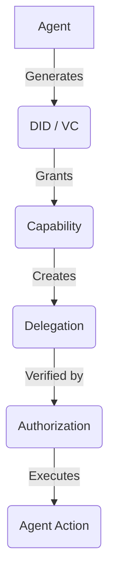
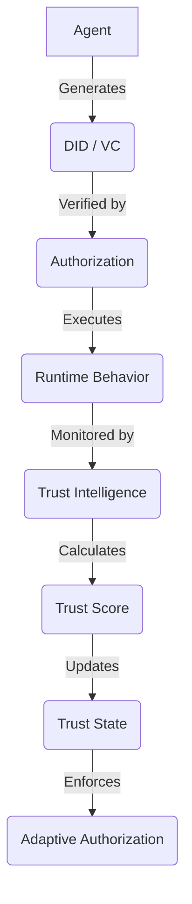

# TrustChain-AI

## Overview
TrustChain-AI is a decentralized trust intelligence framework for secure autonomous AI agent collaboration. Currently, this repository implements the foundational layer: a robust Decentralized Identifier (DID) and Verifiable Credential (VC) infrastructure designed to support capability-based access control and secure agent-to-agent delegation. 

*Note: This repository serves as the baseline implementation originally derived from the Akta project. The behavioral trust mechanics and dynamic intelligence engine are planned as future extensions.*

## Research Motivation
As AI agents become increasingly autonomous, they must interact, delegate tasks, and share resources without human intervention. Traditional centralized identity and access management solutions are a bottleneck for a decentralized multi-agent ecosystem. Agents require a cryptographically secure, verifiable, and decentralized mechanism to prove identity, assert capabilities, and authorize task delegation. Furthermore, static cryptography alone cannot adapt to anomalous runtime behavior, motivating the need for dynamic Trust Intelligence.

## Current Implementation
The current implementation provides the static cryptographic foundation required for decentralized agent identities. It strictly implements W3C DIDs, JSON-LD Verifiable Credentials, Capability encoding, and cryptographic agent-to-agent delegation using Ed25519 signatures.

## Architecture

**Current Architecture:**


**Planned TrustChain-AI Architecture:**


## Key Features
- **DID/Key Management:** Native creation of `did:key` and `did:web` identities.
- **Verifiable Credentials:** W3C-compliant JSON-LD credentials signed with Linked Data Proofs (URDNA2015).
- **Capability Authorization:** Granular permissions mapping skills, scopes, and usage limits.
- **Agent Delegation:** Secure, multi-hop capability delegation between autonomous agents.
- **Verifiable Data Registry (VDR):** Local SQLite registry to store and fetch credentials.
- **Bearer Tokens:** Generation of authorization tokens directly from cryptographically signed VCs.

## System Workflow
1. **Issuer:** A root entity generates a DID.
2. **Agent Identity:** Target agents generate their respective DIDs.
3. **AgentCard / Capabilities:** Agents broadcast their capabilities via AgentCards.
4. **VC Issuance:** Issuer signs a VC granting capabilities to an Agent.
5. **VC Storage / VDR:** The VC is published to the Verifiable Data Registry.
6. **Agent Delegation:** An Agent drafts a child VC to delegate capabilities to another Agent.
7. **Delegated VC:** The child VC links to the parent VC via `delegationDetails`.
8. **Bearer Token:** The delegated Agent creates a bearer token from the VC.
9. **Authorization:** The target API verifies the LDP signature and semantic constraints.
10. **Agent Action:** The API executes the requested capability.

## DID and VC Architecture
Agents are identified using `did:key` or `did:web` identifiers mapped to `Ed25519` key pairs. Verifiable Credentials use the W3C VC Data Model v1.1/v2.0 format. Credentials are canonized using `URDNA2015` and signed using `Ed25519Signature2020` to guarantee non-repudiation.

## Agent-to-Agent Delegation
The system allows a root issuer to grant an agent (e.g., Agent Bob) a capability with `canDelegate: true`. Agent Bob can then act as a localized issuer, signing a new VC delegating that capability to Agent Charlie. The downstream API verifies the entire cryptographic chain.

## Capability-Based Authorization
Credentials contain strict `skills` and `scopes` (e.g., `map:generate`). These capabilities define usage limits, expiration dates, and delegation rights, ensuring downstream actions are cryptographically bounded.

## Credential Lifecycle
Credentials are drafted as JSON payloads, canonically signed, and published to the VDR. They remain valid until their static `expirationDate` or `validUntil` constraints are exceeded. 

## Evidence and Auditability
At issuance, an `Evidence` block is added to the VC capturing an `AgentCardSnapshot` hash. This provides an immutable reference to the agent's stated capabilities when the credential was granted.

## TrustChain-AI Extension Roadmap
*The following features are PLANNED and will be added in future development phases:*
- **Behavioral Telemetry:** Real-time collection of Task Success Rate $S_i^{(t)}$, Protocol Compliance $C_i^{(t)}$, and Normalized Latency $L_i^{(t)}$.
- **Trust-State Engine:** Mathematical computation of a dynamic temporal trust score $T_i^{(t)}$.
- **Behavioral Quarantine:** Adaptive authorization based on continuous trust score monitoring (Trusted, Suspicious, Quarantined, Revoked).
- **Decentralized Trust Intelligence:** Replacing the local VDR with a decentralized ledger for immutable audit trails.

## Project Structure
- `akta/`: Main library (DID, VC, cryptography, CLI, VDR).
- `tests/`: Basic unit tests.
- `docs/`: Technical and architectural documentation.
- `test_delegation_workflow.sh`: Bash script demonstrating end-to-end delegation.

## Requirements
- Python >= 3.11
- `uv` and `hatchling`

## Installation
Clone the repository:
```bash
git clone <repository_url>
cd trustchain-ai/akta-base
```
Install dependencies:
```bash
pip install .
```

## Quick Start
To view available commands:
```bash
akta --help
```

## Running the Demo
Start the VDR service:
```bash
akta vdr serve
```
In a separate terminal, run the E2E script:
```bash
./test_delegation_workflow.sh
```

## Example Workflow
The demo scripts showcase a scenario where a Root Issuer grants Agent Bob the capability to generate maps. Agent Bob subsequently issues a child VC delegating this capability to Agent Charlie. Agent Charlie successfully uses this VC as a Bearer token against a target API. The script also validates that delegation fails if `canDelegate` is false.

## Testing
End-to-end integration tests are implemented in `test_delegation_workflow.sh`. Unit tests are available in the `tests/` directory.

## Security Considerations
This is currently a research prototype. The cryptography relies on standard Ed25519 libraries, but the framework has not undergone a third-party security audit. Dynamic revocation and behavioral isolation are planned but not yet implemented.

## Current Limitations
- Purely static cryptography; lacks dynamic behavioral insights.
- No dynamic revocation status list.
- VDR is centralized to a local SQLite instance.

## Future Work
See the **TrustChain-AI Extension Roadmap** above. Future work will introduce the Trust Intelligence Engine and dynamic behavioral quarantine capabilities.

## Research Context
This codebase forms the static cryptographic baseline for exploring dynamic, behavioral Trust Intelligence in decentralized multi-agent systems.

## License
This project is licensed under the MIT License - see the LICENSE file for details.