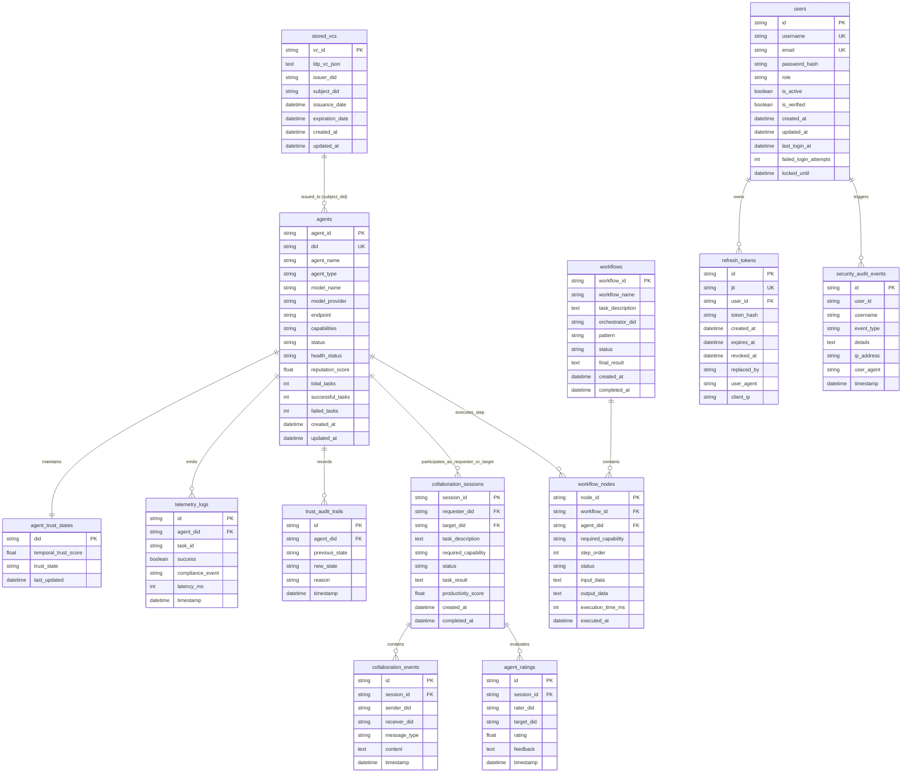

# TrustChain-AI: Database Design & VDR Specification

**TrustChain-AI: A Decentralized Trust Intelligence Framework for Secure Autonomous AI Agent Collaboration**

Department of Computer Engineering, Mukesh Patel School of Technology Management & Engineering (MPSTME), SVKM's NMIMS (Deemed-to-be University), Mumbai  
Academic Session: 2026–2027  
Repository: `https://github.com/Manishpatil0608/trustchain-ai`

---

## 1. Architectural Role of the Verifiable Data Registry (VDR)

In decentralized identity architectures conforming to the W3C DID Core specification, a **Verifiable Data Registry (VDR)** is a system that mediates the creation, resolution, verification, and revocation of Decentralized Identifiers (DIDs) and Verifiable Credentials (VCs).

> [!IMPORTANT]
> **Implementation Clarification: Local SQLite VDR vs. Distributed Blockchain**  
> In TrustChain-AI, the VDR is implemented as an embedded, highly optimized **SQLite 3** relational database configured in **Write-Ahead Logging (WAL)** mode.
> 
> The system intentionally utilizes a local VDR rather than a distributed blockchain ledger. In autonomous multi-agent systems, agents emit high-frequency runtime telemetry streams (hundreds of task observations per minute). A distributed blockchain would introduce prohibitive consensus latency (12–60 seconds per block) and transaction gas fees, making real-time trust decay and policy gating infeasible.
> 
> Cryptographic integrity is guaranteed mathematically:
> - **Self-certifying Identifiers:** W3C `did:key` resolves directly from the public key bytes embedded in the DID string without network lookups.
> - **Linked Data Proofs:** VCs are cryptographically signed using `Ed25519Signature2020` with URDNA2015 canonicalization.
> - **ACID Compliance:** Local SQLite transactions provide atomic updates with sub-millisecond query execution.

---

## 2. Storage Engine Configuration & Pragmas

SQLite is configured via SQLAlchemy event listeners in `akta/vdr/database.py`:

```python
engine = create_engine(
    SQLALCHEMY_DATABASE_URL, 
    connect_args={"check_same_thread": False, "timeout": 30.0}
)

@event.listens_for(engine, "connect")
def set_sqlite_pragma(dbapi_connection, connection_record):
    cursor = dbapi_connection.cursor()
    cursor.execute("PRAGMA journal_mode=WAL")     # Enables Write-Ahead Logging
    cursor.execute("PRAGMA synchronous=NORMAL")   # Balances durability and high IOPS throughput
    cursor.close()
```

### Key Concurrency Properties
- **Concurrent Readers & Writers:** In WAL mode, read transactions never block write transactions, and write transactions never block read transactions. Readers read from the main database file while writers append to the `-wal` file.
- **30-Second Busy Timeout:** If a write transaction is currently committing, subsequent write transactions wait up to 30.0 seconds before raising a lock error, preventing concurrency contention failures.
- **Thread Safety:** `check_same_thread: False` allows FastAPI's async worker threads to reuse pooled connections safely.

---

## 3. Comprehensive Entity-Relationship Model



---

## 4. Detailed Table Specifications

### 1. `stored_vcs` (Verifiable Credential Store)
| Column | Type | Constraints | Description |
|---|---|---|---|
| `vc_id` | `VARCHAR` | `PRIMARY KEY` | Unique credential ID (e.g., `vc_00b13ce69e2d`) |
| `ldp_vc_json` | `TEXT` | `NOT NULL` | Serialized W3C JSON-LD credential with `proof` |
| `issuer_did` | `VARCHAR` | `INDEX` | DID of the issuing entity |
| `subject_did` | `VARCHAR` | `INDEX` | DID of the subject agent |
| `issuance_date` | `DATETIME` | Nullable | Date and time of credential issuance |
| `expiration_date`| `DATETIME` | Nullable | Credential expiry timestamp |
| `created_at` | `DATETIME` | `NOT NULL, DEFAULT CURRENT_TIMESTAMP` | Database insertion timestamp |
| `updated_at` | `DATETIME` | `NOT NULL, DEFAULT CURRENT_TIMESTAMP` | Last record update timestamp |

### 2. `agent_trust_states` (Dynamic Trust Core)
| Column | Type | Constraints | Description |
|---|---|---|---|
| `did` | `VARCHAR` | `PRIMARY KEY` | Unique Agent DID (`did:key:z...`) |
| `temporal_trust_score` | `FLOAT` | `NOT NULL, DEFAULT 1.0` | Continuous EMA score $T_i(t) \in [0.0, 1.0]$ |
| `trust_state` | `VARCHAR` | `NOT NULL, DEFAULT 'TRUSTED'` | State: `TRUSTED`, `SUSPICIOUS`, `QUARANTINED`, `REVOKED` |
| `last_updated` | `DATETIME` | `NOT NULL, DEFAULT CURRENT_TIMESTAMP` | Timestamp of latest telemetry re-evaluation |

### 3. `telemetry_logs` (Runtime Execution Stream)
| Column | Type | Constraints | Description |
|---|---|---|---|
| `id` | `VARCHAR` | `PRIMARY KEY` | Unique telemetry observation UUID |
| `agent_did` | `VARCHAR` | `INDEX, NOT NULL` | Target agent DID |
| `task_id` | `VARCHAR` | `INDEX, NOT NULL` | Associated task or collaboration ID |
| `success` | `BOOLEAN` | `NOT NULL` | True if task succeeded; False on failure |
| `compliance_event` | `VARCHAR` | Nullable | None if compliant; violation string if breached |
| `latency_ms` | `INTEGER` | `NOT NULL, DEFAULT 0` | Task execution duration in milliseconds |
| `timestamp` | `DATETIME` | `NOT NULL, DEFAULT CURRENT_TIMESTAMP` | Observation timestamp |

### 4. `trust_audit_trails` (State Machine History)
| Column | Type | Constraints | Description |
|---|---|---|---|
| `id` | `VARCHAR` | `PRIMARY KEY` | Unique transition record UUID |
| `agent_did` | `VARCHAR` | `INDEX, NOT NULL` | Target agent DID |
| `previous_state` | `VARCHAR` | `NOT NULL` | Prior state (`TRUSTED`, `SUSPICIOUS`, etc.) |
| `new_state` | `VARCHAR` | `NOT NULL` | Transitioned state |
| `reason` | `VARCHAR` | `NOT NULL` | Natural language justification for transition |
| `timestamp` | `DATETIME` | `NOT NULL, DEFAULT CURRENT_TIMESTAMP` | Transition timestamp |

### 5. `agents` (Autonomous Agent Registry)
| Column | Type | Constraints | Description |
|---|---|---|---|
| `agent_id` | `VARCHAR` | `PRIMARY KEY` | Internal agent identifier (`agent_...`) |
| `agent_name` | `VARCHAR` | `NOT NULL` | Human-readable agent display name |
| `did` | `VARCHAR` | `UNIQUE, INDEX, NOT NULL` | Algorithmic W3C DID string |
| `description` | `TEXT` | Nullable | Agent operational brief |
| `agent_type` | `VARCHAR` | `NOT NULL, DEFAULT 'general'` | Role category (orchestrator, worker, auditor) |
| `model_name` | `VARCHAR` | `NOT NULL` | LLM model backbone (e.g., `gemini-1.5-pro`) |
| `model_provider` | `VARCHAR` | `NOT NULL` | LLM provider (Google, Anthropic, OpenAI) |
| `endpoint` | `VARCHAR` | Nullable | HTTP or A2A communication URL |
| `capabilities` | `VARCHAR` | `NOT NULL` | Comma-separated capability tags |
| `status` | `VARCHAR` | `NOT NULL, DEFAULT 'AVAILABLE'` | `AVAILABLE`, `BUSY`, `OFFLINE` |
| `health_status` | `VARCHAR` | `NOT NULL, DEFAULT 'HEALTHY'` | `HEALTHY`, `UNHEALTHY`, `OFFLINE` |
| `reputation_score` | `FLOAT` | `NOT NULL, DEFAULT 5.0` | Historic peer reputation (1.0 - 5.0) |
| `total_tasks` | `INTEGER` | `NOT NULL, DEFAULT 0` | Cumulative tasks executed |
| `successful_tasks`| `INTEGER` | `NOT NULL, DEFAULT 0` | Successful task executions |
| `failed_tasks` | `INTEGER` | `NOT NULL, DEFAULT 0` | Failed task executions |

---

## 5. Maintenance, Migration & Backup Procedures

### Zero-Downtime WAL Checkpoint Backup
To safely back up the SQLite database while the application is actively processing telemetry:
```python
import sqlite3
import shutil

# Step 1: Force WAL journal pages to commit into the main database file
conn = sqlite3.connect("vdr.db")
conn.execute("PRAGMA wal_checkpoint(TRUNCATE)")
conn.close()

# Step 2: Safely duplicate the consistent database snapshot
shutil.copy2("vdr.db", "backups/vdr_backup.db")
```

### Clean Database Initialization
```bash
python scripts/database/init_db.py
python scripts/database/seed_demo_data.py
```
This initializes all 13 tables and seeds standard demonstration agents without requiring an internet connection.
