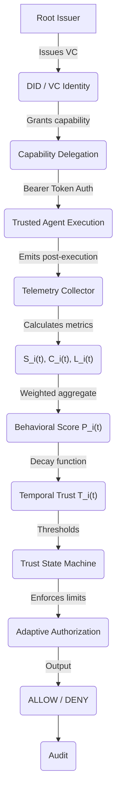

# TrustChain-AI Final Architecture

## Logical Pipeline

## Architectural Separation

The framework is strictly divided into two orthogonal layers.

### STATIC SECURITY LAYER
This layer is inherited directly from the original Akta baseline. It is fundamentally cryptographic and static.
- **DID (Decentralized Identifiers)**: `did:key` identity resolution.
- **VC (Verifiable Credentials)**: JSON-LD capabilities mapping permissions.
- **Ed25519 Signatures**: Ensuring credential authenticity.
- **Capability Delegation**: Multi-hop Agent-to-Agent authorization (`canDelegate`).

### DYNAMIC TRUST LAYER
This layer constitutes the core of TrustChain-AI. It evaluates continuous behavior over time.
- **Telemetry**: Success flags, protocol compliance, latency.
- **Behavior**: Real-time evaluation of performance quality.
- **Trust**: Mathematical temporal decay model blending history with recent events.
- **State**: Deterministic mapping of trust scores to predefined tiers (TRUSTED, SUSPICIOUS, QUARANTINED, REVOKED).
- **Authorization**: Adaptive policy enforcement middleware intercepting valid VCs and actively blocking access if trust is compromised.
