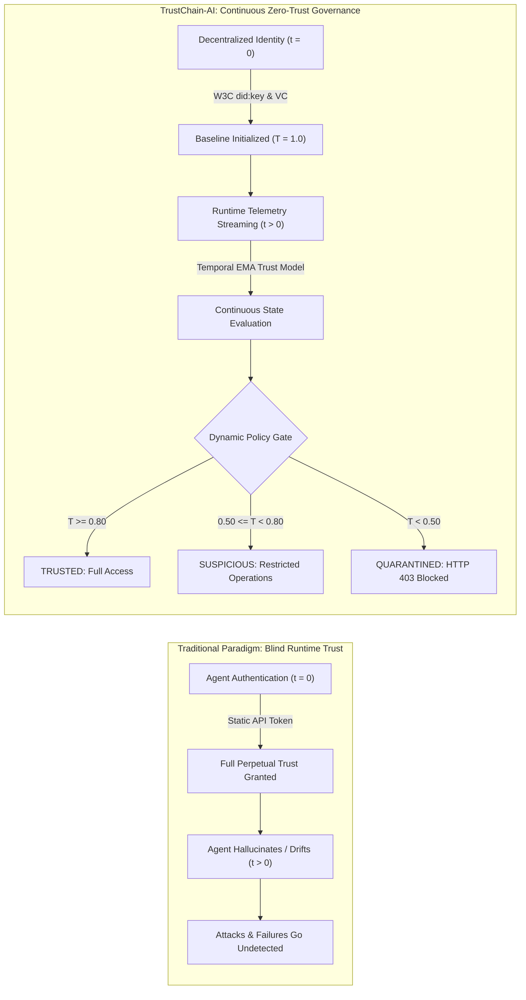

# TrustChain-AI: Project Overview

**TrustChain-AI: A Decentralized Trust Intelligence Framework for Secure Autonomous AI Agent Collaboration**

Department of Computer Engineering, Mukesh Patel School of Technology Management & Engineering (MPSTME), SVKM's NMIMS (Deemed-to-be University), Mumbai  
Academic Session: 2026–2027  
Repository: `https://github.com/Manishpatil0608/trustchain-ai`

---

## 1. Executive Summary

Autonomous Multi-Agent Systems (MAS) represent the next frontier of distributed enterprise computing, where AI agents autonomously communicate, discover capabilities, delegate complex sub-tasks, and invoke privileged software tools without human intervention. However, existing multi-agent architectures rely on traditional **static point-in-time security models** (e.g., API tokens, mTLS certificates, or static OAuth2 scopes). 

Under this legacy paradigm, once an agent is authenticated at connection initialization ($t = 0$), it is granted perpetual, blind trust for the duration of the session. In reality, autonomous AI agents operate stochastically: an authenticated agent can experience prompt injection, goal drift, reasoning hallucinations, SLA latency spikes, or resource exhaustion at runtime ($t > 0$).

**TrustChain-AI** fundamentally addresses this vulnerability by unifying:
1. **Decentralized Cryptographic Identity:** Algorithmic public-key identity via W3C `did:key` (Ed25519) and W3C Linked Data Proof Verifiable Credentials (VCs).
2. **Continuous Behavioral Trust Intelligence:** Runtime evaluation of telemetry streams (task success rate, protocol compliance, and latency penalties) using a temporal Exponential Moving Average (EMA) mathematical model.
3. **Adaptive Zero-Trust Policy Gating:** Real-time enforcement intercepts privileged operations, restricts suspicious agents, and immediately quarantines degraded agents (HTTP 403 Forbidden).

---

## 2. Problem Statement: The Point-in-Time Security Failure

Traditional identity systems answer the question: *"Who are you?"* at entry. They cannot answer: *"Are you behaving securely and reliably right now?"* during runtime execution.

### Empirical Failure Modes in Multi-Agent Systems
1. **Point-of-Entry Failure:** Stolen API tokens allow unauthorized entities unrestricted access because no behavioral validation exists.
2. **Behavioral Drift & Hallucination:** Agents executing non-deterministic LLM loops produce invalid intermediate formats, corrupting downstream sequential workflows.
3. **Protocol & Policy Non-Compliance:** Unchecked agents attempt unauthorized privilege escalation or violate schema constraints.
4. **Cascading Latency Failures:** Slow or unresponsive agents stall multi-agent collaborative task execution, degrading overall system throughput.

---

## 3. Capability Implementation Matrix

To ensure absolute academic transparency, every platform capability in TrustChain-AI is categorized by its actual implementation status in the codebase:

| Capability | Module / Component | Implementation Status | Implementation Evidence |
|---|---|:---:|---|
| **W3C `did:key` Generation & Resolution** | `akta/did.py` | **Implemented** | Pure-math Ed25519 multibase key encoding (`0xED01`), self-certifying, no external CA |
| **W3C Linked Data Proof VCs** | `akta/credentials.py` | **Implemented** | URDNA2015 dataset canonicalization, Ed25519 signature suite (`Ed25519Signature2020`) |
| **Local Verifiable Data Registry (VDR)** | `akta/vdr/` | **Implemented** | SQLite WAL-mode ACID persistence (13 tables), sub-millisecond query execution |
| **Runtime Behavioral Telemetry** | `akta/telemetry.py` | **Implemented** | REST ingestion of task success flags, compliance violations, and latency |
| **Temporal EMA Trust Scoring** | `akta/trust_engine.py` | **Implemented** | Discrete EMA decay formulation with multi-factor behavioral weighting |
| **Four-State Machine Engine** | `akta/trust_engine.py` | **Implemented** | Deterministic transitions: `TRUSTED`, `SUSPICIOUS`, `QUARANTINED`, `REVOKED` |
| **Zero-Trust Policy Interception** | `akta/adaptive_auth.py` | **Implemented** | Policy decision point; HTTP 403 on quarantine; privilege restriction on suspicious |
| **Agent Registry & Catalog** | `akta/vdr/registry_router.py`| **Implemented** | Agent registration, endpoint health checks, operational status toggles |
| **Eligibility-Based Discovery** | `akta/vdr/registry_crud.py` | **Implemented** | Capability search filtering out quarantined, revoked, or unhealthy nodes |
| **Multi-Factor Task-Aware Matching** | `akta/vdr/registry_crud.py` | **Implemented** | Composite scoring: trust (0.4), reputation (0.3), success rate (0.2), latency (0.1) |
| **Inter-Agent Collaboration Sessions**| `akta/vdr/registry_router.py`| **Implemented** | Session lifecycle: `PENDING` -> `ACCEPTED` -> `ACTIVE` -> `COMPLETED` |
| **Sequential Multi-Agent Workflows** | `akta/vdr/registry_router.py`| **Implemented** | Sequential DAG execution with trust-gate verification at each step |
| **Immutable Audit Trail** | `akta/vdr/trust_crud.py` | **Implemented** | Cryptographic logging of every state change with decision reason |
| **Human RBAC Authentication** | `akta/auth/` | **Implemented** | Argon2 hashing, JWT access tokens, rotating refresh tokens with reuse detection |
| **Interactive SOC Dashboard** | `frontend/src/` | **Implemented** | 16 views in React 19, Recharts temporal graphs, Lucide icons, dark theme |
| **Simulated Tool Connectors** | `akta/connectors.py` | **Simulated** | Deterministic mock connectors for external API interactions |
| **Distributed Blockchain VDR** | N/A | **Planned** | Current VDR is local SQLite; distributed ledger anchoring is future research |

---

## 4. Architectural Summary

TrustChain-AI consists of four integrated layers:
1. **Presentation Layer:** React 19 Single Page Application (SOC Operations Center).
2. **API & Policy Layer:** FastAPI REST backend enforcing JWT authentication, RBAC, and `AdaptivePolicyEnforcer` zero-trust gating.
3. **Core Intelligence Layer:** Decentralized identity resolvers (`did:key`), Verifiable Credential managers, and the Temporal Trust Engine.
4. **Authoritative Persistence Layer:** Embedded SQLite 3 Verifiable Data Registry with Write-Ahead Logging.
