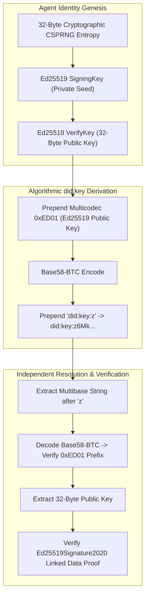

# TrustChain-AI: Security Architecture & Threat Model

**TrustChain-AI: A Decentralized Trust Intelligence Framework for Secure Autonomous AI Agent Collaboration**

Department of Computer Engineering, Mukesh Patel School of Technology Management & Engineering (MPSTME), SVKM's NMIMS (Deemed-to-be University), Mumbai  
Academic Session: 2026–2027  
Repository: `https://github.com/Manishpatil0608/trustchain-ai`

---

## 1. Zero-Trust Security Philosophy

TrustChain-AI aligns directly with the core tenets of the **NIST SP 800-207 Zero Trust Architecture (ZTA)**:
1. **Never Trust, Always Verify:** All resource accesses are verified explicitly, continuously, and dynamically.
2. **Dynamic Policy Enforcement:** Authorization is not a binary static handshake, but a continuously computed function of cryptographic identity and runtime behavioral integrity.
3. **Least Privilege Operation:** Degraded or suspicious nodes are systematically restricted from privileged orchestrations while remaining permitted to execute lower-risk tasks under heightened telemetry logging.

---

## 2. Threat Modeling & STRIDE Matrix Analysis

The system threat model analyzes potential adversarial actions against autonomous multi-agent environments:

| Threat Category | Potential Attack Vector | TrustChain-AI Architectural Mitigation |
|---|---|---|
| **Spoofing (S)** | An attacker attempts to impersonate a legitimate autonomous agent or orchestrator. | **W3C `did:key` Identity:** Every agent possesses an asymmetric Ed25519 keypair. The public key is derived algorithmically from the DID string. Credentials and requests must be digitally signed with `Ed25519Signature2020`. Spoofing requires breaking 256-bit elliptic curve cryptography. |
| **Tampering (T)** | An adversary intercepts and alters inter-agent payloads or modifies issued credentials. | **W3C Linked Data Proofs (LDP):** Verifiable Credentials undergo URDNA2015 RDF canonicalization and SHA-256 hashing before signing. Any payload tampering invalidates the cryptographic proof immediately. |
| **Repudiation (R)** | A rogue agent denies having emitted malformed data or violating a protocol rule. | **Dual Audit Logging:** Telemetry logs and trust state machine transitions are immutably written to `telemetry_logs` and `trust_audit_trails` with nanosecond timestamps, agent DIDs, and transition reasons. |
| **Information Disclosure (I)** | Unauthorized extraction of user passwords, signing keys, or tokens. | **Argon2id & Secret Management:** Passwords are never stored in plaintext; they are hashed with Argon2id using dynamic salts. Private keys remain strictly with the agent runtime. JWT access tokens have 30-minute lifetimes. |
| **Denial of Service (D)** | An agent floods downstream nodes with high-latency requests or resource-heavy loops. | **Normalized Latency Penalty ($L_i(t)$):** Any agent whose average latency exceeds 2000 ms receives full latency penalties, dragging its temporal trust score down into `QUARANTINED` isolation within 2–3 rounds. |
| **Elevation of Privilege (E)** | A compromised worker attempts to trigger administrative revocation or orchestrate workflows. | **`AdaptivePolicyEnforcer` Gating:** Privileged operations (`workflow:execute`, `agent:delegate`, `admin:revoke`) require both `TRUSTED` state ($T \ge 0.80$) and appropriate human RBAC authorization. |

---

## 3. Cryptographic Key Management & Decentralized Identity

### Self-Certifying Properties
- The agent's identifier (`did:key:z6Mk...`) is self-certifying: the public verification key is mathematically extracted directly from the identifier string itself.
- No central Certificate Authority (CA) or remote network resolution is required, completely eliminating DNS spoofing, CA compromise, and man-in-the-middle certificate substitution.

---

## 4. Human Authentication, JWT & RBAC Model

TrustChain-AI implements enterprise-grade authentication for security personnel and SOC operators:

### A. Role-Based Access Control (RBAC) Matrix

| Operational Capability | `VIEWER` | `OPERATOR` | `ADMIN` |
|---|:---:|:---:|:---:|
| View Dashboard & Telemetry Feeds | Yes | Yes | Yes |
| Inspect Registered Agents & DIDs | Yes | Yes | Yes |
| View Trust Analytics & Audit Trails | Yes | Yes | Yes |
| Ingest Test Telemetry Events | No | Yes | Yes |
| Trigger Agent Health Probes | No | Yes | Yes |
| Initiate Collaboration Sessions | No | Yes | Yes |
| Register & Execute Multi-Agent Workflows | No | Yes | Yes |
| Administratively Revoke / Quarantine Agents | No | No | Yes |
| User Administration (Create, Disable, Roles) | No | No | Yes |
| Invalidate Active User Sessions | No | No | Yes |

### B. Rotating Refresh Tokens & Reuse Detection
- **Short-Lived Access Tokens:** Signed using HMAC-SHA256 (`APP_AUTH_SECRET`), valid for 30 minutes.
- **Single-Use Refresh Tokens:** Stored as cryptographic hashes (`refresh_tokens` table) with unique JWT IDs (`jti`).
- **Cryptographic Reuse Detection:** If an adversary attempts to present an already-rotated refresh token, the server immediately invalidates the entire refresh token family for that user, terminating all active sessions and recording a `REUSE_DETECTED` security audit event.

### C. Brute-Force Lockout Protection
- After 5 consecutive failed login attempts (`APP_LOGIN_MAX_ATTEMPTS`), the target account is automatically locked for 15 minutes (`APP_LOGIN_LOCKOUT_MINUTES`), mitigating automated credential stuffing.

---

## 5. Production Hardening Checklist

When transitioning TrustChain-AI from a local research environment to an enterprise production deployment:
1. **Rotate Signing Secret:** Replace `APP_AUTH_SECRET` in `.env` with a cryptographically secure random string of at least 32 bytes (`openssl rand -hex 32`).
2. **Enforce HTTPS / TLS 1.3:** Place the application behind a reverse proxy (e.g., Nginx, Cloudflare, Traefik) terminating TLS with strong cipher suites.
3. **Restrict CORS Origins:** Set `APP_CORS_ALLOWED_ORIGINS` strictly to authorized production domain names.
4. **Disable Auto-Seeding:** Set `APP_DEV_AUTO_SEED_ADMIN=False` once initial administrative credentials have been configured.
5. **Secure Database Permissions:** Ensure the `vdr.db` file is owned by the application service account with read/write permissions restricted to `chmod 600`.
