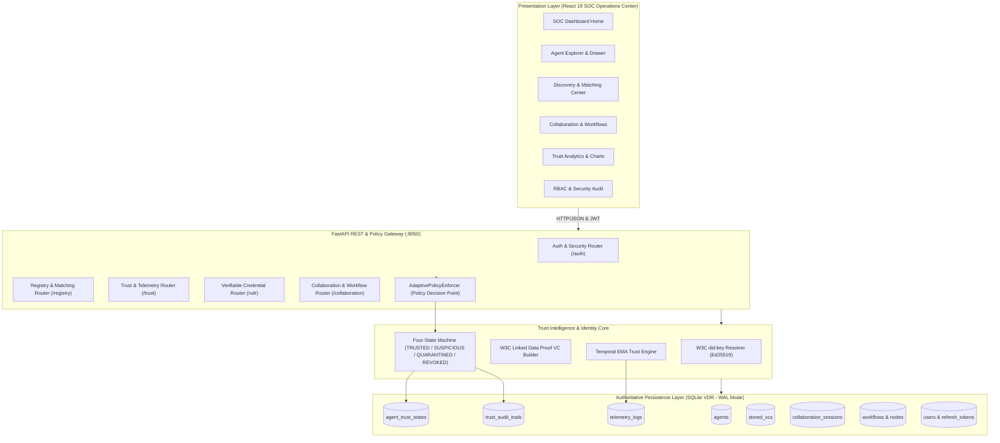
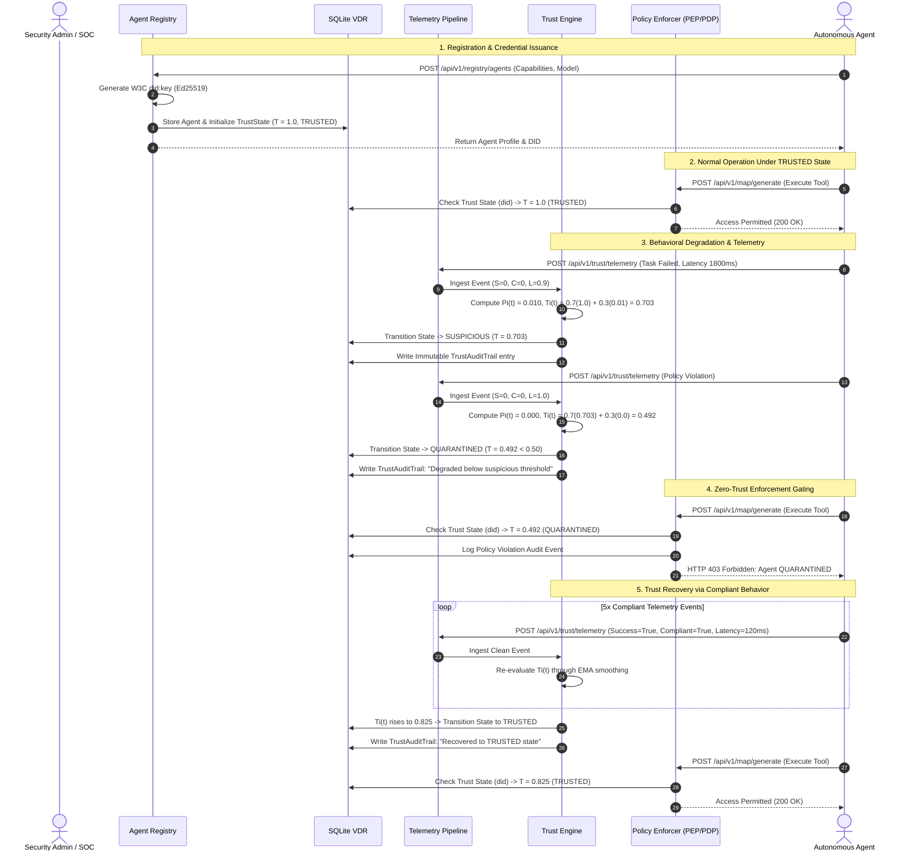
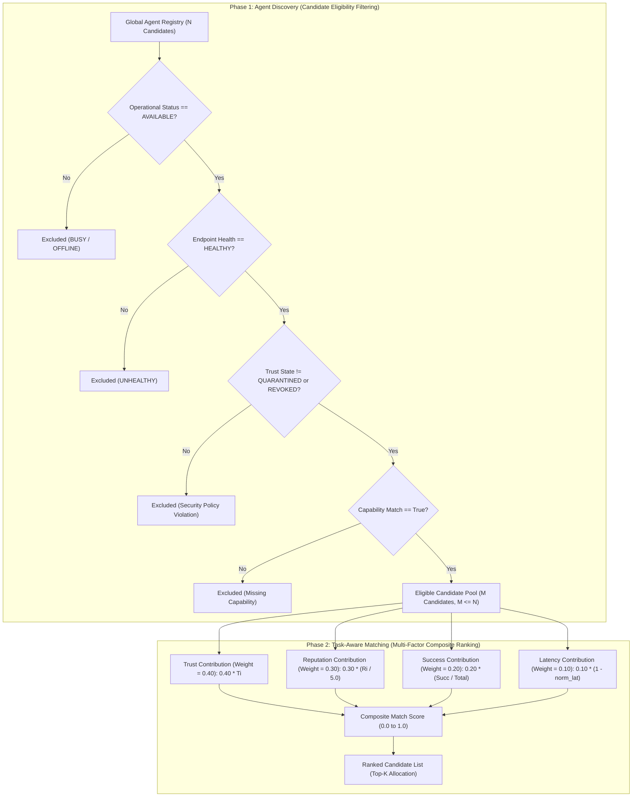

# TrustChain-AI: System Architecture

**TrustChain-AI: A Decentralized Trust Intelligence Framework for Secure Autonomous AI Agent Collaboration**

Department of Computer Engineering, Mukesh Patel School of Technology Management & Engineering (MPSTME), SVKM's NMIMS (Deemed-to-be University), Mumbai  
Academic Session: 2026–2027  
Repository: `https://github.com/Manishpatil0608/trustchain-ai`

---

## 1. High-Level Architectural Blueprint

TrustChain-AI decouples identity verification from runtime authorization by introducing a continuous behavioral feedback loop between agent execution, telemetry ingestion, mathematical trust evaluation, and zero-trust policy gating.



---

## 2. Core Architectural Subsystems

### A. Presentation Layer (React 19 SPA)
- Built with React 19, Vite 8, and TailwindCSS 4.
- Communicates with FastAPI via Axios with automatic Bearer token injection and HTTP-only cookie refresh rotation.
- Visualizes real-time temporal decay timelines, matching score breakdowns, radar capability maps, and state machine transitions.

### B. REST API & Policy Gateway (FastAPI)
- Exposes 39 authoritative REST endpoints across 7 functional routers.
- Enforces request-level security headers: `X-Request-ID`, `X-Content-Type-Options: nosniff`, `X-Frame-Options: DENY`, `Referrer-Policy: strict-origin-when-cross-origin`.
- Configured with CORS middleware allowing authorized origins (`http://localhost:5173`, `http://localhost:8050`).

### C. Zero-Trust Policy Decision Point (`AdaptivePolicyEnforcer`)
Located in `akta/adaptive_auth.py`, the `AdaptivePolicyEnforcer` evaluates the agent's current trust state before permitting any protected operation:

```text
Operation Request -> AdaptivePolicyEnforcer
                         │
        ┌────────────────┼────────────────┬────────────────┐
        ▼                ▼                ▼                ▼
     TRUSTED        SUSPICIOUS       QUARANTINED        REVOKED
   (T >= 0.80)   (0.50 <= T < 0.80)   (T < 0.50)   (Terminal State)
        │                │                │                │
     PERMIT        Privileged?          DENY             DENY
    (Full Access)  ├── Yes -> DENY (403) (HTTP 403)     (Permanent)
                   └── No  -> PERMIT (Monitored)
```

- **Privileged Operations:** `workflow:execute`, `workflow:orchestrate`, `agent:delegate`, `credential:issue`, `admin:revoke`, `admin:manage`, `sensitive:execute`.
- **Standard Operations:** `read`, `query`, `map:generate`, `task:execute`, `collaboration:step`, `collaboration:participate`.

### D. Decentralized Identity & Credential Core
- **`akta/did.py`:** Algorithmic public-key derivation using the W3C `did:key` method. Generates 32-byte Ed25519 signing seeds, derives public verification keys, prepends multicodec prefix `0xED01`, and encodes as base58btc with prefix `z`.
- **`akta/credentials.py`:** Implements W3C Verifiable Credentials with Linked Data Proofs (LDP). Normalizes RDF datasets via the URDNA2015 canonicalization algorithm, computes SHA-256 digests, and generates cryptographic signatures using `Ed25519Signature2020`.

### E. Temporal Behavioral Trust Engine
- **`akta/trust_engine.py`:** Evaluates sliding-window runtime observations into normalized metrics:
  - Task Success Rate $S_i(t) \in [0, 1]$
  - Protocol Compliance $C_i(t) \in [0, 1]$
  - Normalized Latency Penalty $L_i(t) \in [0, 1]$
- Computes single-period behavioral score:
  $$P_i(t) = 0.6 S_i(t) + 0.3 C_i(t) + 0.1 (1 - L_i(t))$$
- Applies temporal Exponential Moving Average smoothing with decay parameter $\lambda = 0.7$:
  $$T_i(t) = 0.7 T_i(t-1) + 0.3 P_i(t)$$

### F. Verifiable Data Registry (Local SQLite VDR)
- Embedded SQLite 3 database operating in Write-Ahead Logging (`WAL`) mode.
- Guarantees ACID transactional semantics with zero network consensus overhead.
- Persists 13 tables covering credentials, agents, trust scores, telemetry, workflows, sessions, and security audits.

---

## 3. End-to-End Behavioral Life Cycle Sequence

The following sequence diagram illustrates the lifecycle from agent registration, credential issuance, telemetry degradation, quarantine gating, to trust recovery:



---

## 4. Multi-Agent Discovery vs. Task-Aware Matching Architecture

TrustChain-AI maintains a strict architectural distinction between **Discovery** and **Matching**:



---

## 5. Security Architecture & Boundary Layers

1. **Perimeter Boundary:** Reverse proxy with CORS validation, HTTP security headers, and rate limiting.
2. **Identity Boundary:** Pure algorithmic W3C `did:key` resolution; verification keys cannot be forged because the DID string is the encoded public key itself.
3. **Session Boundary:** JWT access tokens (30m expiry) with Argon2-hashed passwords and rotating HTTP-only refresh tokens.
4. **Behavioral Policy Boundary:** The `AdaptivePolicyEnforcer` enforces continuous zero-trust gating at the point of tool or workflow execution.
5. **Storage Boundary:** Local SQLite database with WAL journaling, foreign keys, and cryptographic audit records.
