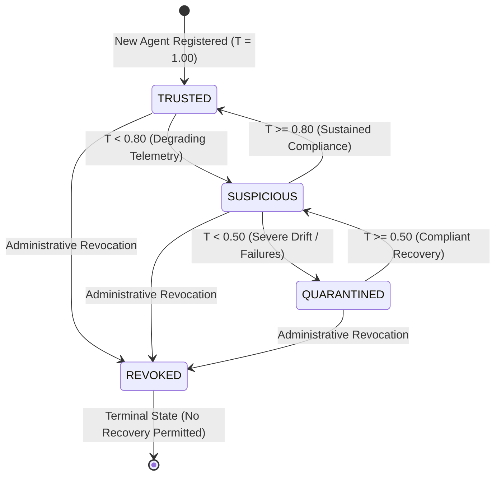

# TrustChain-AI: Mathematical Trust Model & Algorithm

**TrustChain-AI: A Decentralized Trust Intelligence Framework for Secure Autonomous AI Agent Collaboration**

Department of Computer Engineering, Mukesh Patel School of Technology Management & Engineering (MPSTME), SVKM's NMIMS (Deemed-to-be University), Mumbai  
Academic Session: 2026–2027  
Repository: `https://github.com/Manishpatil0608/trustchain-ai`

---

## 1. Mathematical Formulation

The TrustChain-AI Trust Engine (`akta/trust_engine.py`) models the trustworthiness of autonomous agents via continuous, sliding-window behavioral telemetry observations. It operates as a discrete-time dynamical system that unifies immediate behavioral performance with historical reputation memory.

### A. Sub-Metric Derivation

For an agent $i$ over an observation window $t$ containing $N$ telemetry events:

1. **Task Success Rate ($S_i(t)$):**
   $$S_i(t) = \frac{\sum_{k=1}^N \mathbf{1}_{\{\text{success}_k = \text{True}\}}}{N}$$
   Where $\mathbf{1}$ is the indicator function. If no events are observed, $S_i(t) = 1.0$ (optimistic initialization).

2. **Protocol Compliance Rate ($C_i(t)$):**
   $$C_i(t) = \frac{\sum_{k=1}^N \mathbf{1}_{\{\text{compliance\_event}_k = \text{None}\}}}{N}$$
   A compliance event denotes a detected violation (e.g., unauthorized scope query, schema mismatch, or rate-limit overrun). If no violations occur, $C_i(t) = 1.0$.

3. **Normalized Latency Penalty ($L_i(t)$):**
   $$\overline{\text{lat}}_i = \frac{1}{N} \sum_{k=1}^N \text{latency}_{k} \quad (\text{in ms})$$
   $$L_i(t) = \min\left(1.0, \max\left(0.0, \frac{\overline{\text{lat}}_i}{\text{max\_latency\_ms}}\right)\right)$$
   Where $\text{max\_latency\_ms} = 2000\text{ ms}$. If an agent responds instantaneously, $L_i(t) \to 0$. If an agent exceeds 2000 ms, $L_i(t) = 1.0$.

---

### B. Single-Period Behavioral Score ($P_i(t)$)

The multi-factor behavioral score $P_i(t) \in [0.0, 1.0]$ combines the three sub-metrics using verified weights:

$$P_i(t) = w_1 S_i(t) + w_2 C_i(t) + w_3 (1 - L_i(t))$$

Where:
- $w_1 = 0.60$ (Weight assigned to Task Success Rate)
- $w_2 = 0.30$ (Weight assigned to Protocol Compliance)
- $w_3 = 0.10$ (Weight assigned to SLA Latency Compliance)
- Constraint: $w_1 + w_2 + w_3 = 0.60 + 0.30 + 0.10 = 1.00$

$$P_i(t) = 0.60 \cdot S_i(t) + 0.30 \cdot C_i(t) + 0.10 \cdot (1 - L_i(t))$$

---

### C. Temporal Trust Score ($T_i(t)$)

To prevent sudden oscillations caused by isolated transient anomalies, TrustChain-AI applies **Exponential Moving Average (EMA)** temporal smoothing:

$$T_i(t) = \lambda \cdot T_i(t-1) + (1 - \lambda) \cdot P_i(t)$$

Where:
- $\lambda = 0.70$ (Historical memory decay coefficient, balancing responsiveness and stability)
- $1 - \lambda = 0.30$ (Sensitivity to immediate behavioral performance)
- $T_i(0) = 1.00$ (Initial baseline trust score upon cryptographic DID registration)

Substituting $\lambda = 0.70$:

$$T_i(t) = 0.70 \cdot T_i(t-1) + 0.30 \cdot P_i(t)$$

---

## 2. Deterministic State Machine Transitions

The temporal trust score $T_i(t)$ maps deterministically into four discrete operational states:



| Trust State | Score Boundary | Operational Authorization Policy |
|---|:---:|---|
| **`TRUSTED`** | $T_i(t) \ge 0.80$ | **Full Access:** Authorized for both standard operations and privileged workflows. |
| **`SUSPICIOUS`** | $0.50 \le T_i(t) < 0.80$ | **Restricted Authorization:** Privileged operations (`workflow:execute`, `credential:issue`, `agent:delegate`) are blocked with HTTP 403. Lower-risk operations (`task:execute`, `map:generate`) are permitted under heightened monitoring and security audit logging. |
| **`QUARANTINED`** | $T_i(t) < 0.50$ | **Zero Access:** Denied all protected operations (HTTP 403 Forbidden). Node is isolated. |
| **`REVOKED`** | Terminal State | **Permanently Blocked:** Administratively triggered. Never recovers, regardless of telemetry. |

---

## 3. Step-by-Step Numerical Walkthrough (Degradation & Recovery)

The following table demonstrates the exact mathematical progression of an agent starting at pristine trust ($T=1.00$), suffering repeated failures, transitioning through `SUSPICIOUS` into `QUARANTINED`, and subsequently recovering:

| Round ($t$) | Success ($S$) | Compliance ($C$) | Latency ($L$) | $P_i(t)$ Formula | $P_i(t)$ | $T_i(t-1)$ | $T_i(t)$ Formula | $T_i(t)$ | Resulting State |
|:---:|:---:|:---:|:---:|:---:|:---:|:---:|:---:|:---:|:---:|
| **R0** | - | - | - | Initial Baseline | 1.000 | - | - | **1.0000** | `TRUSTED` |
| **R1** | 1.0 | 1.0 | 0.06 (120ms) | $0.6(1.0) + 0.3(1.0) + 0.1(0.94)$ | 0.994 | 1.000 | $0.7(1.000) + 0.3(0.994)$ | **0.9982** | `TRUSTED` |
| **R2** | 1.0 | 1.0 | 0.12 (240ms) | $0.6(1.0) + 0.3(1.0) + 0.1(0.88)$ | 0.988 | 0.998 | $0.7(0.998) + 0.3(0.988)$ | **0.9950** | `TRUSTED` |
| **R3** | 0.0 | 0.0 | 0.85 (1700ms)| $0.6(0.0) + 0.3(0.0) + 0.1(0.15)$ | 0.015 | 0.995 | $0.7(0.995) + 0.3(0.015)$ | **0.7010** | `SUSPICIOUS` |
| **R4** | 0.0 | 0.0 | 0.95 (1900ms)| $0.6(0.0) + 0.3(0.0) + 0.1(0.05)$ | 0.005 | 0.701 | $0.7(0.701) + 0.3(0.005)$ | **0.4922** | `QUARANTINED` |
| **R5** | 0.0 | 0.0 | 1.00 (2000ms)| $0.6(0.0) + 0.3(0.0) + 0.1(0.00)$ | 0.000 | 0.492 | $0.7(0.492) + 0.3(0.000)$ | **0.3445** | `QUARANTINED` |
| **R6** | 1.0 | 1.0 | 0.10 (200ms) | $0.6(1.0) + 0.3(1.0) + 0.1(0.90)$ | 0.990 | 0.345 | $0.7(0.345) + 0.3(0.990)$ | **0.5385** | `SUSPICIOUS` |
| **R7** | 1.0 | 1.0 | 0.08 (160ms) | $0.6(1.0) + 0.3(1.0) + 0.1(0.92)$ | 0.992 | 0.539 | $0.7(0.539) + 0.3(0.992)$ | **0.6749** | `SUSPICIOUS` |
| **R8** | 1.0 | 1.0 | 0.07 (140ms) | $0.6(1.0) + 0.3(1.0) + 0.1(0.93)$ | 0.993 | 0.675 | $0.7(0.675) + 0.3(0.993)$ | **0.7704** | `SUSPICIOUS` |
| **R9** | 1.0 | 1.0 | 0.05 (100ms) | $0.6(1.0) + 0.3(1.0) + 0.1(0.95)$ | 0.995 | 0.770 | $0.7(0.770) + 0.3(0.995)$ | **0.8378** | `TRUSTED` |
| **R10**| 1.0 | 1.0 | 0.05 (100ms) | $0.6(1.0) + 0.3(1.0) + 0.1(0.95)$ | 0.995 | 0.838 | $0.7(0.838) + 0.3(0.995)$ | **0.8851** | `TRUSTED` |

---

## 4. Key Properties of the Algorithm

1. **Rapid Degradation:** Two consecutive severe failure events (R3, R4) immediately plunge trust from $0.995$ to $0.492$, instantly triggering `QUARANTINED` isolation and protecting downstream agents from contaminated outputs.
2. **Gradual, Earned Recovery:** Once quarantined, an agent cannot instantly jump back into full trust. It requires four consecutive compliant rounds (R6 through R9) to earn back its `TRUSTED` status ($T \ge 0.80$).
3. **Mathematical Boundedness:** Because $S, C, (1-L) \in [0, 1]$ and weights sum to $1.0$, $P_i(t)$ is strictly bounded in $[0.0, 1.0]$. Since $T_i(0) \in [0, 1]$, $T_i(t) \in [0.0, 1.0]$ for all $t \ge 0$.
4. **Irreversibility of Revocation:** When an administrative revocation occurs (`trust_crud.revoke_agent`), the state is permanently set to `REVOKED`. The `determine_state` method explicitly checks:
   ```python
   if current_state == TrustState.REVOKED:
       return TrustState.REVOKED
   ```
   Ensuring security administrators maintain absolute override authority.
