# TrustChain-AI — System Architecture Diagrams

All diagrams are in Mermaid syntax. Render with any Mermaid-compatible renderer.

---

## Figure 1: Overall System Architecture

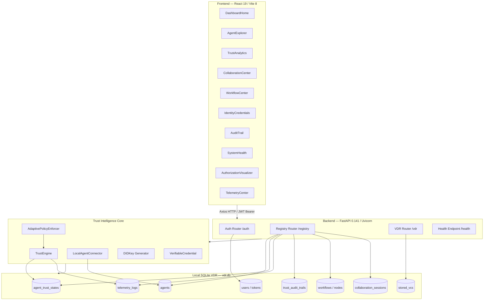

---

## Figure 2: Layered Architecture

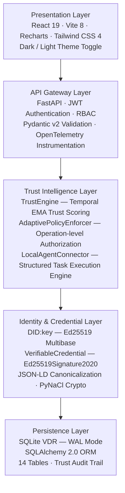

---

## Figure 3: Trust Evaluation Flowchart

```mermaid
flowchart TD
    A[Telemetry Event Submitted] --> B[Load Last 10 Events for Agent]
    B --> C["Compute S_i(t) = success_count / n"]
    C --> D["Compute C_i(t) = compliance_count / n"]
    D --> E["Compute L_i(t) = avg_latency_ms / 2000 capped at 1.0"]
    E --> F["P_i(t) = 0.6 × S_i(t) + 0.3 × C_i(t) + 0.1 × (1 − L_i(t))"]
    F --> G[Load prior T_i(t-1) from agent_trust_states]
    G --> H["T_i(t) = 0.7 × P_i(t) + 0.3 × T_i(t-1)"]
    H --> I{T_i(t) threshold?}
    I -->|T >= 0.8| J[State = TRUSTED]
    I -->|0.5 <= T < 0.8| K[State = SUSPICIOUS]
    I -->|T < 0.5| L[State = QUARANTINED]
    J --> M[Update agent_trust_states]
    K --> M
    L --> M
    M --> N[Write trust_audit_trail record]
    N --> O[Return updated trust score + state]
```

---

## Figure 4: Trust State Transition Diagram

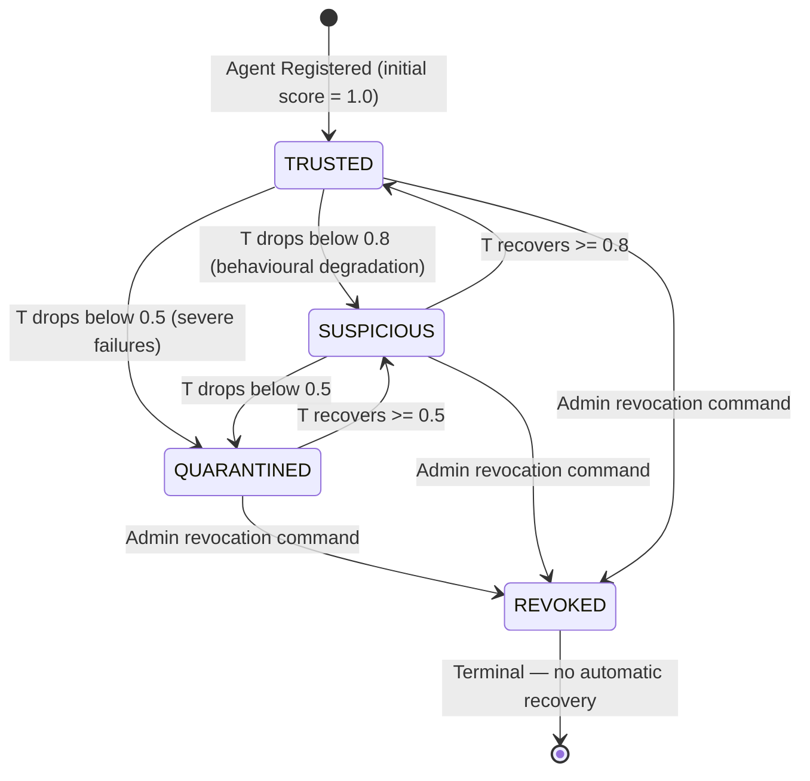

---

## Figure 5: Adaptive Authorization Flow

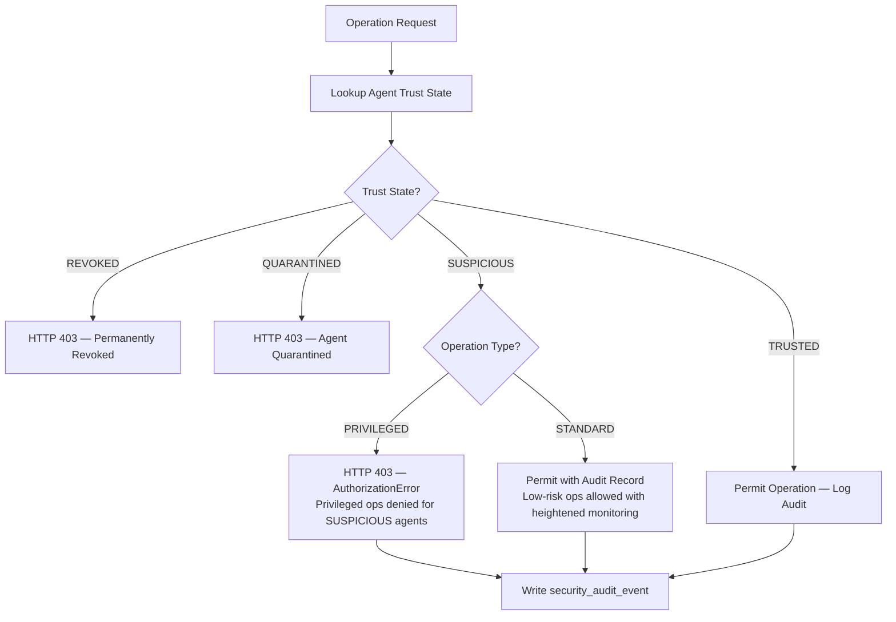

---

## Figure 6: Agent Discovery and Matching

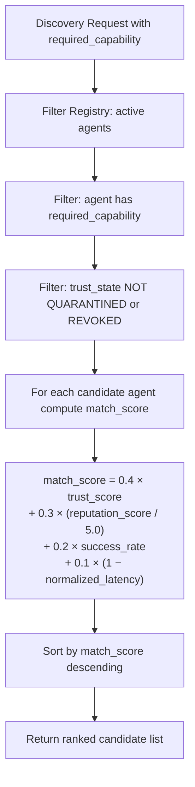

---

## Figure 7: Sequential Workflow Execution

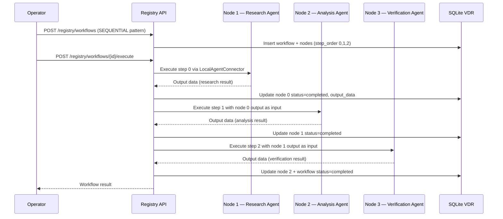

---

## Figure 8: Collaboration Session Lifecycle

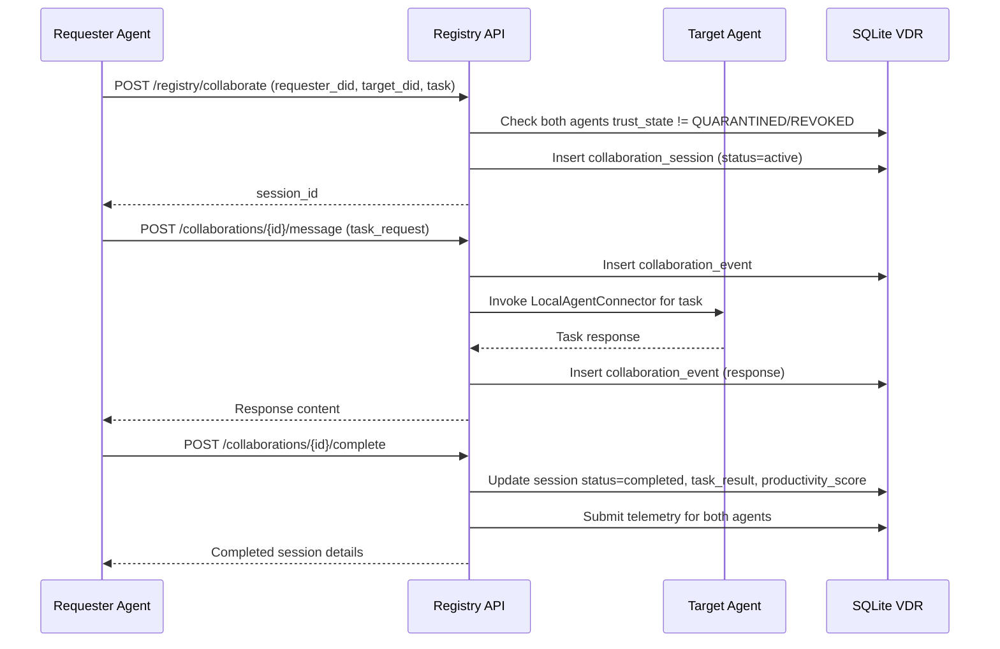

---

## Figure 9: Database Entity-Relationship Diagram

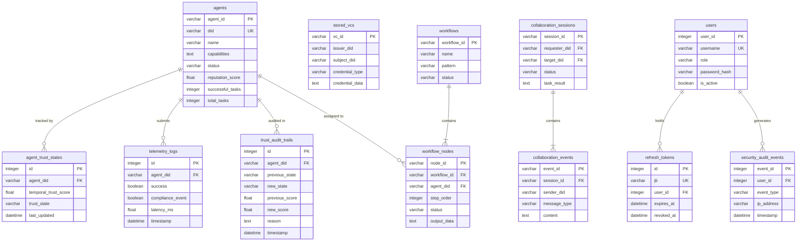

---

## Figure 10: DID Key Generation Flowchart

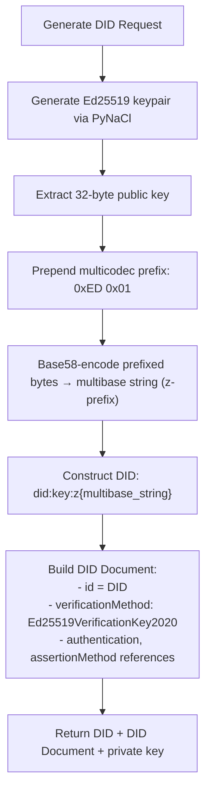

---

## Figure 11: System Context Diagram

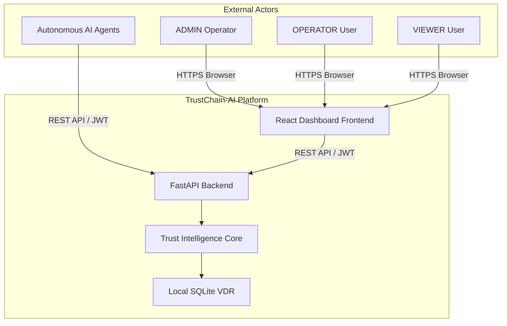

---

## Figure 12: Security Architecture

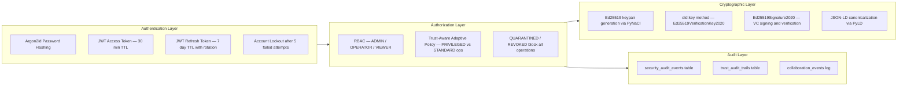
